# LAPORAN PRAKTIKUM PEMROGRAMAN BERBASIS OBJEK

| Informasi Praktikan | Keterangan |
| :--- | :--- |
| **Nama** | Ardhelia Salsabila |
| **NPM** | 4525210092 |
| **Kelas** | A |
| **Mata Kuliah** | Pemrograman Berbasis Objek (PBO) |
| **Pertemuan** | 10 - Exception Handling dan Pemrograman Defensif |
| **Tanggal** | 6 November 2026 |

---

## 1. Implementasi Java

Proyek Java disusun dengan struktur baku Maven (`pom.xml`, `src/main/java/id/ac/univpancasila/perpustakaan/...`). Seluruh kegagalan domain pada Sistem Perpustakaan (anggota tidak terdaftar, ISBN tidak ada, stok habis, batas pinjam tercapai) kini dimodelkan sebagai *exception* turunan `PerpustakaanException`, sehingga method `pinjam()` tidak lagi mengembalikan `false` tanpa alasan.

### 1.1. File: `PerpustakaanException.java`
**Penjelasan Kode:**
> `PerpustakaanException` adalah kelas **abstract** yang menjadi induk semua exception domain perpustakaan. Kelas ini diturunkan dari `RuntimeException`, sehingga bersifat **unchecked**. Ada dua constructor `protected`: satu menerima `pesan`, satu lagi menerima `pesan` dan `penyebab` (`Throwable`) untuk membungkus exception lain.
>
> **Alasan memilih unchecked** (dijelaskan lengkap di `skenario-uji.md`):
> * Semua kegagalan di sistem ini berasal dari permintaan yang tidak sesuai aturan, bukan dari kondisi luar yang wajar seperti jaringan atau berkas terputus.
> * Jika dibuat checked, setiap method seperti `pinjam()` wajib menulis `throws` dan setiap pemanggil dipaksa membungkusnya dengan `try-catch`.
> * PHP tidak mengenal checked exception, sehingga pilihan unchecked membuat perilaku Java dan PHP konsisten.
>
> Manfaat induk bersama: pemanggil cukup memakai satu `catch (PerpustakaanException e)` untuk menangkap seluruh kegagalan domain, tanpa ikut menelan kesalahan pemrograman lain. Analoginya seperti loket pengaduan umum di kantor: semua jenis keluhan resmi masuk ke satu loket yang sama, tetapi keluhan di luar urusan kantor (misalnya listrik padam) tidak ikut tertampung di sana.

**Bukti Eksekusi (Screenshot):**
* **Before** *(Kondisi awal / Kesalahan kompilasi)*:
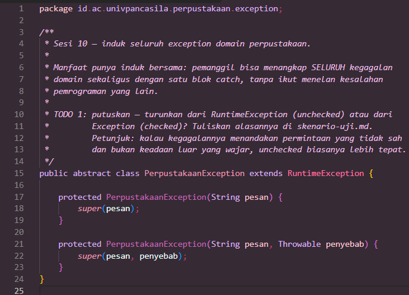

* **After** *(Kondisi akhir / Eksekusi berhasil)*:
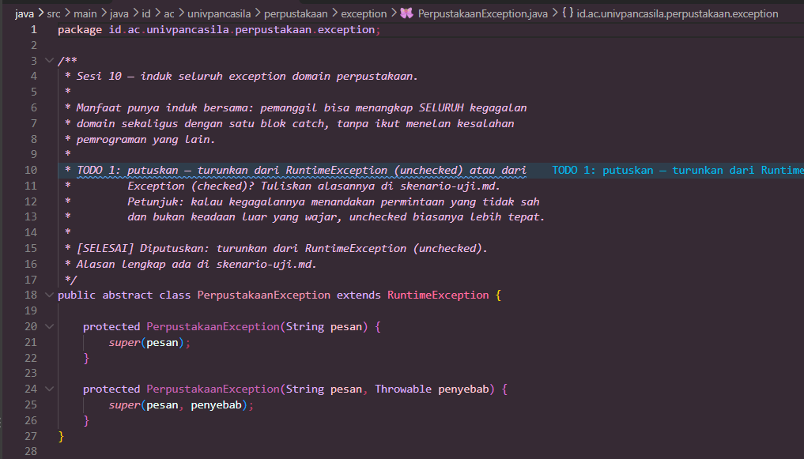

### 1.2. File: `AnggotaTidakDitemukanException.java`
**Penjelasan Kode:**
> Exception ini dilempar ketika ID anggota belum terdaftar. Pada kondisi awal, kelas hanya berisi instruksi `TODO` untuk melengkapinya mengikuti pola `BukuTidakDitemukanException`. Setelah dilengkapi, kelas memiliki atribut `private final String idAnggota`, constructor yang memanggil `super("Anggota dengan ID " + idAnggota + " tidak ditemukan")` lalu menyimpan `idAnggota`, serta getter `getIdAnggota()`.
>
> Dengan menyimpan `idAnggota` sebagai atribut, pemanggil dapat mengambil data penyebab secara langsung tanpa harus mengurai kalimat pesan. Ibaratnya struk belanja: selain tulisan "pembayaran gagal", struk juga mencantumkan nomor transaksinya sehingga petugas bisa langsung menelusuri.

**Bukti Eksekusi (Screenshot):**
* **Before** *(Kondisi awal / Kesalahan kompilasi)*:
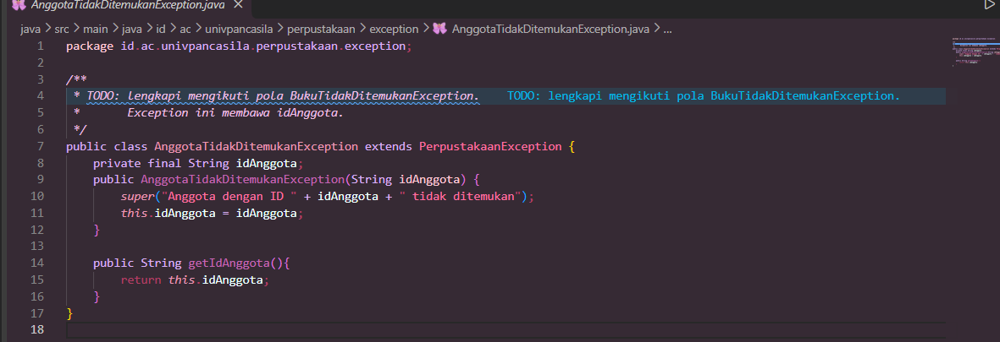

* **After** *(Kondisi akhir / Eksekusi berhasil)*:
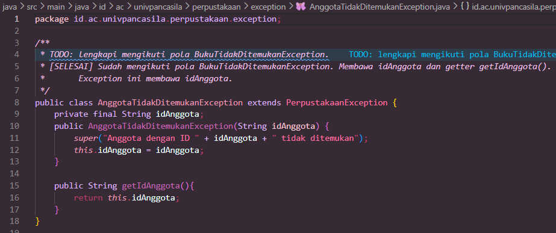

### 1.3. File: `BatasPinjamTerlampauiException.java`
**Penjelasan Kode:**
> Exception ini dilempar ketika jumlah pinjaman anggota sudah mencapai `BATAS_PINJAM` (3 buku). Exception membawa **dua data**: `idAnggota` dan `batas`, masing-masing dengan getter (`getIdAnggota()` dan `getBatas()`).
>
> Menyertakan `batas` di dalam exception membuat pemanggil dapat menyusun pesan, misalnya "Batas Maksimum: 3 buku", tanpa perlu mengetahui aturan peminjamannya sendiri. Seperti petugas parkir yang menolak mobil dan sekaligus menyebutkan kapasitas maksimum areanya, sehingga pengemudi paham alasannya.

**Bukti Eksekusi (Screenshot):**
* **Before** *(Kondisi awal / Kesalahan kompilasi)*:
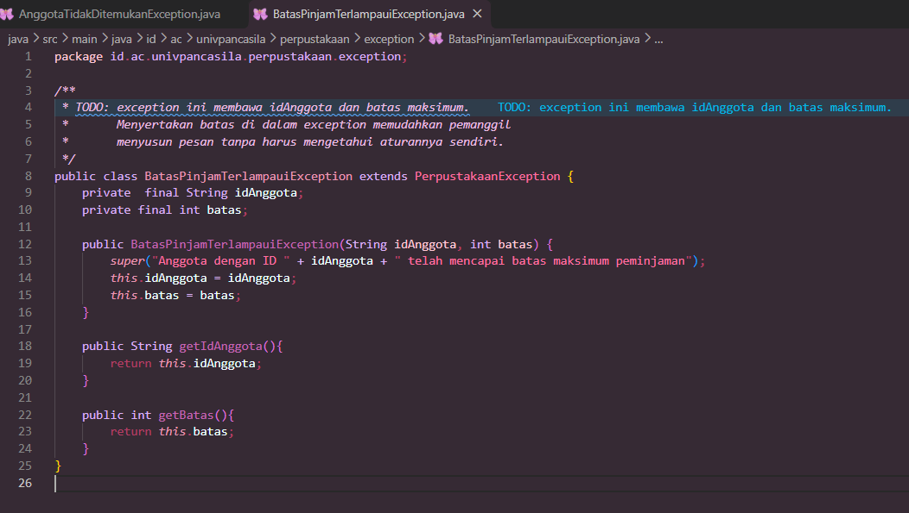

* **After** *(Kondisi akhir / Eksekusi berhasil)*:
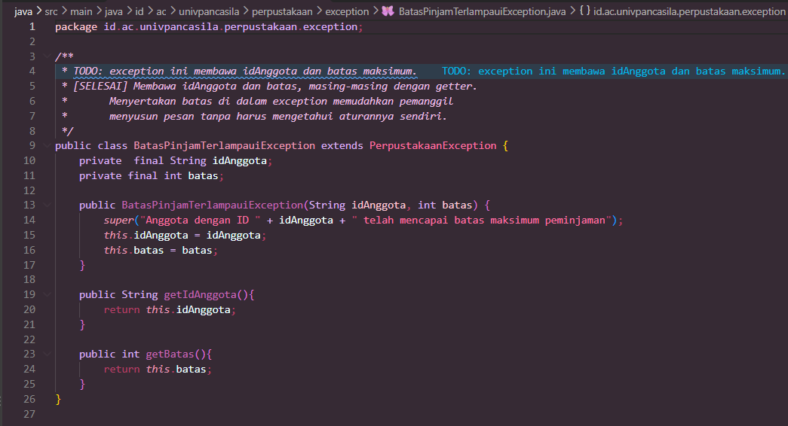

### 1.4. File: `BukuSedangDipinjamException.java`
**Penjelasan Kode:**
> Exception ini dilempar ketika stok eksemplar suatu buku sudah habis (`stok <= 0`). Exception membawa **dua data**, yaitu `isbn` dan `judul`, dengan getter `getIsbn()` dan `getJudul()`. Pesan yang dihasilkan menyebut keduanya: `"Buku <judul> dengan ISBN <isbn> sedang dipinjam"`.
>
> Pembagian perannya: `judul` membuat pesan lebih bermakna bagi pengguna, sedangkan `isbn` memudahkan sistem mengolah data secara tepat. Seperti papan "Buku habis" di rak yang mencantumkan nama buku (untuk pembaca) sekaligus nomor kodenya (untuk petugas).

**Bukti Eksekusi (Screenshot):**
* **Before** *(Kondisi awal / Kesalahan kompilasi)*:
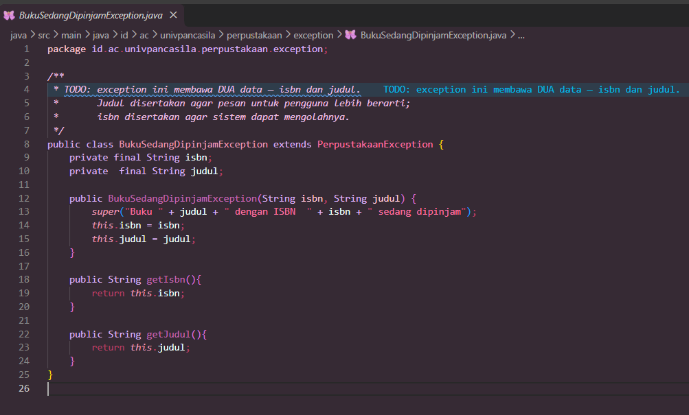

* **After** *(Kondisi akhir / Eksekusi berhasil)*:
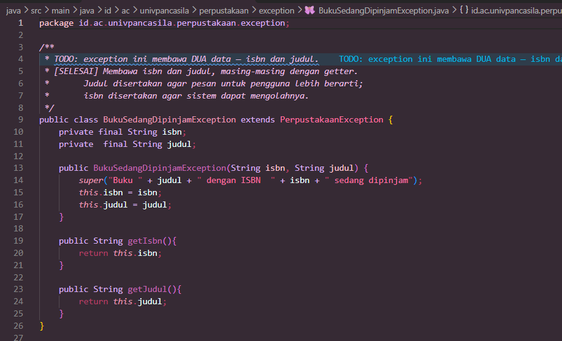

### 1.5. File: `BukuTidakDitemukanException.java`
**Penjelasan Kode:**
> Exception ini dilempar ketika ISBN tidak ada di katalog. Kelas ini menjadi **pola acuan** untuk exception lainnya karena menunjukkan konsep *exception yang membawa data*. Empat TODO diselesaikan berurutan:
> 1. Mendeklarasikan atribut `private final String isbn`.
> 2. Memanggil `super("Buku dengan ISBN " + isbn + " tidak ditemukan")` agar pesan menyebut ISBN-nya.
> 3. Menyimpan `isbn` ke atribut melalui `this.isbn = isbn`.
> 4. Menyediakan getter `getIsbn()`.
>
> Pada sesi 13 dan 14, data `isbn` ini akan dipakai sebagai isi badan respons HTTP 404.

**Bukti Eksekusi (Screenshot):**
* **Before** *(Kondisi awal / Kesalahan kompilasi)*:
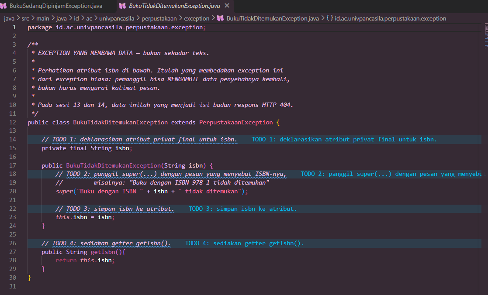

* **After** *(Kondisi akhir / Eksekusi berhasil)*:
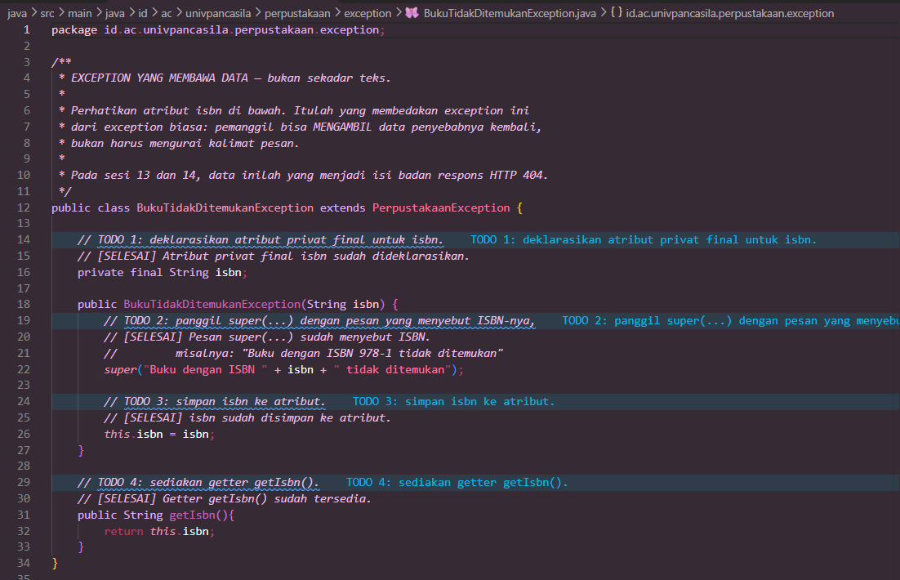

### Output
**Alur Program:**
> * `LibraryService.pinjam()` sudah direfaktor memakai **guard clause**: keempat kondisi gagal (anggota tidak ada, buku tidak ada, stok habis, batas tercapai) diperiksa berurutan di awal dan langsung melempar exception, sehingga logika utama (`stok.merge(...)` dan `pinjaman.merge(...)`) berada di tingkat paling luar. Versi lama yang bersarang empat tingkat dan hanya mengembalikan `false` disimpan di `LibraryServiceKotor.java` sebagai pembanding.
> * `PerpustakaanService.pinjamBuku()` menangkap `PerpustakaanException`, menampilkan `getMessage()`, lalu memakai `instanceof` untuk menampilkan data khusus tiap exception (ISBN, ID anggota, judul buku, atau batas maksimum). Exception di luar domain ditangkap oleh `catch (Exception e)` terpisah.
> * `Main.java` menyediakan menu (Tambah Buku, Tambah Anggota, Pinjam Buku, Keluar) dan mengekspor laporan ke `laporan_buku.txt` setelah program keluar.
>
> Proyek dikompilasi dan dijalankan dengan Maven. Pada screenshot, buku "Laut Bercerita" (ISBN `978-602-424-694-5`, 40 eksemplar) ditambahkan, anggota `4525210092` didaftarkan, lalu peminjaman berhasil.

**Output Program:**
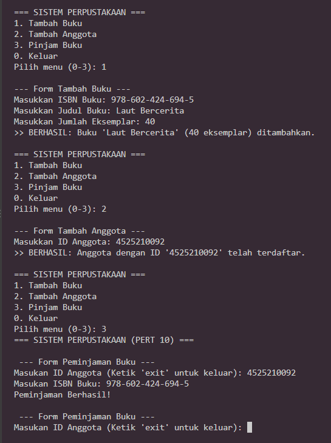

---

## 2. Implementasi PHP

Proyek PHP memakai Composer dengan autoload PSR-4 (`"Perpustakaan\\": "src/"`) sehingga seluruh kelas dimuat cukup dengan `require __DIR__ . '/vendor/autoload.php';` di `main.php`. Hierarki exception dibuat sejajar dengan versi Java, dengan *constructor property promotion* dan properti `readonly`.

### 2.1. File: `AnggotaTidakDitemukanException.php`
**Penjelasan Kode:**
> Kelas `final` yang meng-extend `PerpustakaanException` (turunan `RuntimeException`). Pada kondisi awal, kelas masih berisi komentar `TODO 3`. Setelah dilengkapi, `$idAnggota` dideklarasikan langsung di constructor sebagai `private readonly string` (*constructor property promotion*), `parent::__construct("Anggota dengan ID {$idAnggota} tidak ditemukan.")` mengisi pesan, dan `getIdAnggota(): string` menyediakan akses ke datanya.
>
> Properti `readonly` membuat data penyebab tidak bisa diubah setelah exception dibuat, seperti catatan di berita acara yang sudah ditandatangani dan tidak boleh dicoret lagi.

**Bukti Eksekusi (Screenshot):**
* **Before** *(Kondisi awal / Galat logika)*:
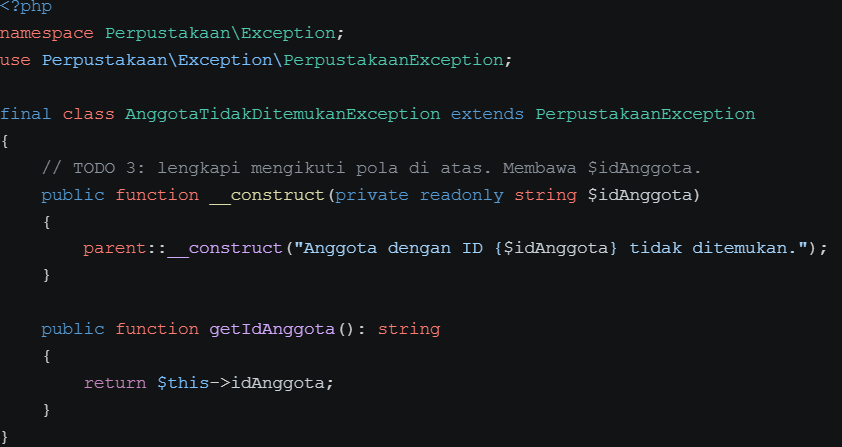

* **After** *(Kondisi akhir / Eksekusi berhasil)*:
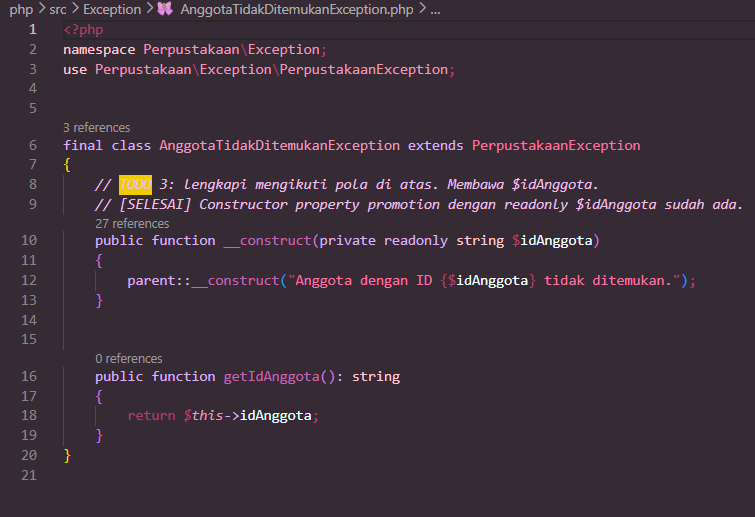

### 2.2. File: `BatasPinjamTerlampauiException.php`
**Penjelasan Kode:**
> Exception ini membawa `$idAnggota` dan `$batas` sebagai properti `private readonly` yang dideklarasikan lewat constructor, masing-masing dengan getter bertipe kembalian (`getIdAnggota(): string` dan `getBatas(): int`). Pesan yang dihasilkan: `"Anggota {$idAnggota} telah mencapai batas peminjaman ({$batas} buku)."`. Exception dilempar oleh `LibraryService::pinjam()` ketika `$this->pinjaman[$idAnggota] >= self::BATAS_PINJAM`.

**Bukti Eksekusi (Screenshot):**
* **Before** *(Kondisi awal / Galat logika)*:
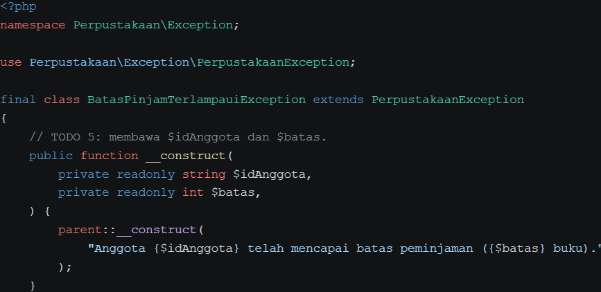

* **After** *(Kondisi akhir / Eksekusi berhasil)*:
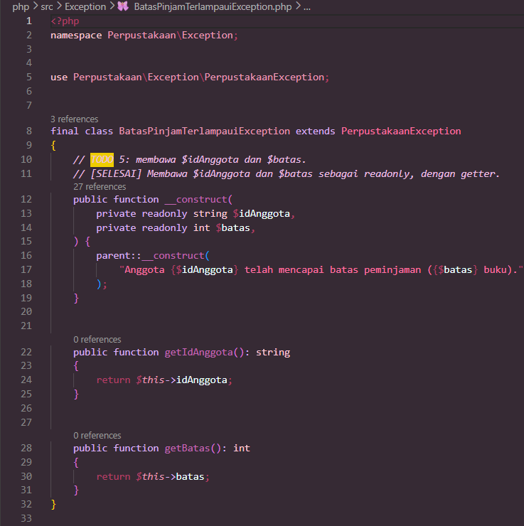

### 2.3. File: `BukuSedangDipinjamException.php`
**Penjelasan Kode:**
> Exception ini membawa `$isbn` dan `$judul` sebagai properti `private readonly` dengan getter `getIsbn()` dan `getJudul()`. Pesan yang dihasilkan: `"Buku \"{$judul}\" (ISBN {$isbn}) sedang dipinjam."`. Exception dilempar ketika `$this->stok[$isbn] <= 0`.

**Bukti Eksekusi (Screenshot):**
* **Before** *(Kondisi awal / Galat logika)*:
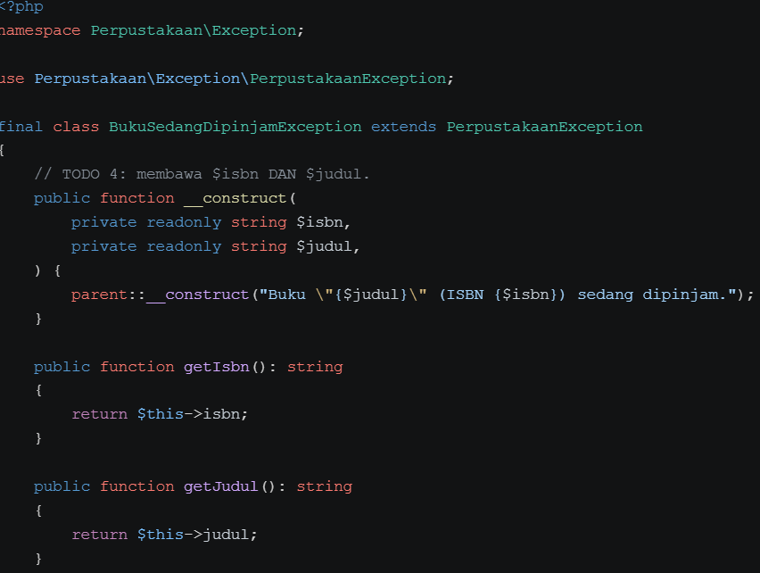

* **After** *(Kondisi akhir / Eksekusi berhasil)*:
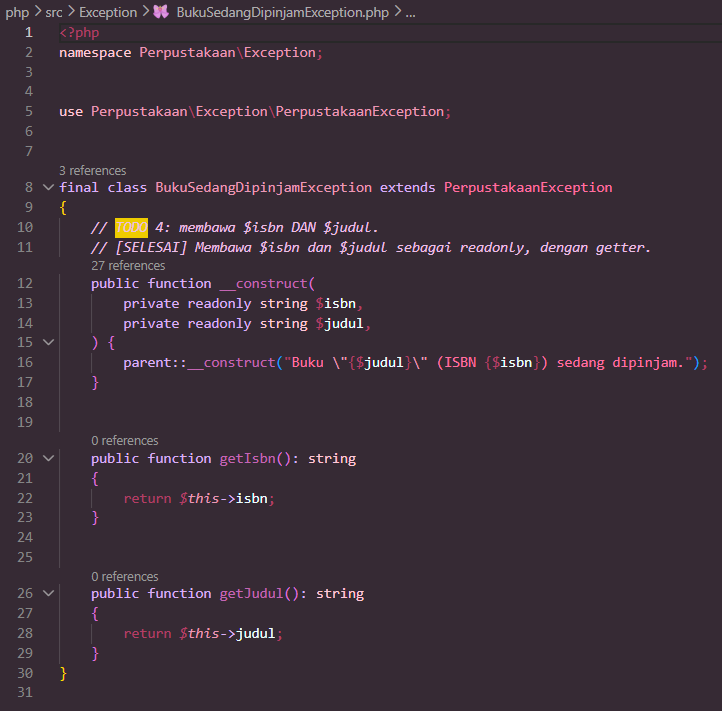

### 2.4. File: `BukuTidakDitemukanException.php`
**Penjelasan Kode:**
> Pola acuan versi PHP. `$isbn` disimpan lewat *constructor property promotion* (`private readonly string $isbn`), constructor memanggil `parent::__construct("Buku dengan ISBN {$isbn} tidak ditemukan.")`, dan getter `getIsbn(): string` disediakan. Exception dilempar ketika ISBN tidak ditemukan pada `$this->stok` (`array_key_exists`).
>
> Karena PHP tidak punya checked exception dan kompilator tidak membantu pembaca kode, kontrak method `LibraryService::pinjam()` didokumentasikan lewat anotasi `@throws` pada PHPDoc untuk keempat exception.

**Bukti Eksekusi (Screenshot):**
* **Before** *(Kondisi awal / Galat logika)*:
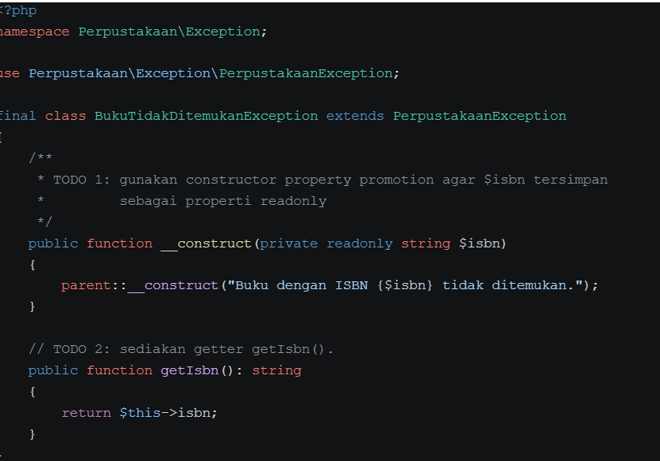

* **After** *(Kondisi akhir / Eksekusi berhasil)*:
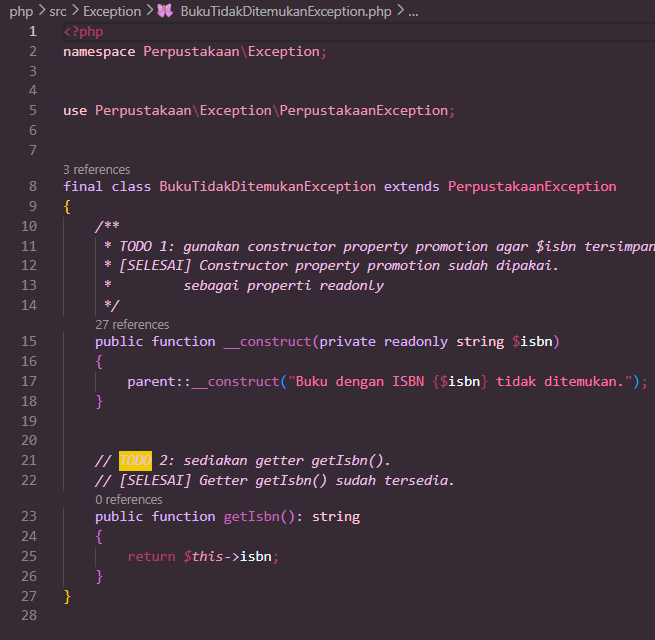

### Output
**Alur Program:**
> `main.php` menjalankan tujuh skenario peminjaman dalam satu perulangan, masing-masing dibungkus `try-catch (PerpustakaanException $e)`:
>
> | No | Anggota | ISBN | Hasil |
> | :-: | :--- | :--- | :--- |
> | 1 | A-001 | 111 | Berhasil |
> | 2 | A-002 | 111 | Gagal, buku sedang dipinjam (stok habis) |
> | 3 | A-002 | 999 | Gagal, buku tidak ditemukan |
> | 4 | X-999 | 222 | Gagal, anggota tidak ditemukan |
> | 5 | A-001 | 222 | Berhasil |
> | 6 | A-001 | 222 | Berhasil |
> | 7 | A-001 | 222 | Gagal, batas peminjaman (3 buku) tercapai |
>
> Setelah itu fungsi `createReport()` menulis `laporan_buku.txt`. Penutupan berkas dijamin oleh blok `finally` sehingga `fclose()` tetap dijalankan walaupun terjadi error di tengah penulisan (pesan `[INFO] File 'laporan_buku.txt' telah ditutup dengan aman melalui blok finally.` tampil pada output). Program dijalankan dengan PHP 8.5.12 melalui perintah `php main.php`.

**Output Program:**
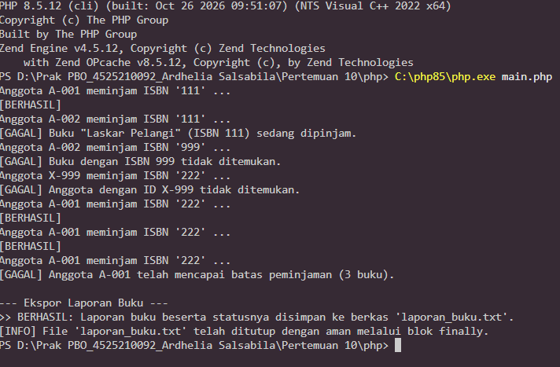

---

## 3. Kesimpulan
> Pada praktikum ini, kegagalan proses peminjaman buku yang sebelumnya hanya ditandai dengan `return false` (tanpa alasan) diganti dengan hierarki exception domain yang diturunkan dari satu induk `PerpustakaanException`, baik di Java maupun PHP. Beberapa poin penting yang diperoleh:
>
> 1. **Exception membawa data, bukan sekadar teks.** Atribut seperti `isbn`, `idAnggota`, `judul`, dan `batas` dapat diambil kembali melalui getter, sehingga pemanggil tidak perlu mengurai kalimat pesan.
> 2. **Memilih unchecked exception** (`RuntimeException`) membuat kode pemanggil lebih bersih dan konsisten dengan PHP yang tidak mengenal checked exception. Konsekuensinya, kontrak kegagalan harus didokumentasikan lewat Javadoc di Java dan `@throws` di PHP.
> 3. **Guard clause** pada `LibraryService.pinjam()` menggantikan `if` bersarang empat tingkat, sehingga alur utama lebih mudah dibaca dan penambahan aturan baru lebih mudah dilakukan.
> 4. **Blok `finally`** (dan `try-with-resources` pada Java) menjamin sumber daya seperti berkas ditutup dengan aman meskipun terjadi kesalahan.
> 5. **Maven dan Composer** (autoload PSR-4) merapikan struktur proyek: kelas ditemukan berdasarkan namespace/package yang sesuai dengan jalur foldernya.
>
> Secara keseluruhan, kedua implementasi menghasilkan perilaku yang setara: setiap kegagalan domain dapat dikenali penyebabnya dan ditangani secara terarah.
