# LAPORAN PRAKTIKUM PEMROGRAMAN BERBASIS OBJEK

| Informasi Praktikan | Keterangan |
| :--- | :--- |
| **Nama** | Ardhelia Salsabila Al-Bahri |
| **NPM** | 4525210092 |
| **Kelas** | A |
| **Mata Kuliah** | Pemrograman Berbasis Objek (PBO) |
| **Pertemuan** | 11 -  Collections, Generics, dan Operasi Fungsional |
| **Tanggal** | 14 November 2026 |

---

## 1. Implementasi Java

### 1.1. File: `Repository.java`
**Penjelasan Kode:**
> `Repository<T>` adalah kelas generik buatan sendiri. `<T>` berperan sebagai *type parameter*, sehingga satu kelas dapat dipakai untuk tipe apa pun, dan setelah dipakai sebagai `Repository<Buku>` kompilator memastikan hanya `Buku` yang bisa masuk dan keluar. Data disimpan dalam `LinkedHashMap<String, T>` agar urutan penyimpanan terjaga. Kelas ini tidak perlu tahu isi `T` karena kunci tiap item diambil lewat `Function<T, String> pengambilKunci` yang dikirim melalui konstruktor (contoh pemakaian: `new Repository<>(Buku::isbn)`).
>
> Method yang diselesaikan pada praktikum ini:
> - `simpan(T item)`: mengambil kunci dengan `pengambilKunci.apply(item)` lalu `data.put(...)`. Item dengan kunci yang sama menimpa data lama.
> - `cariById(String id)` (TODO 2): mengembalikan `Optional.ofNullable(data.get(id))`, berisi item bila ada dan kosong bila tidak ada, tanpa pernah mengembalikan `null`.
> - `cariSemua()` (TODO 3): mengembalikan `List.copyOf(data.values())`, yaitu salinan tak-berubah sehingga koleksi internal tidak bocor ke luar (pelajaran sesi 7).
> - `hapus(String id)` (TODO 4): mengembalikan `true` bila ada item yang terhapus, dengan memeriksa `data.remove(id) != null`.
> - `jumlah()`: mengembalikan `data.size()`.

**Bukti Eksekusi (Screenshot):**
* **Before** *(Kondisi awal / Kesalahan kompilasi)*: method `cariById`, `cariSemua`, dan `hapus` masih diberi penanda TODO 2-4 beserta komentar `// ganti`, dan VS Code menampilkan peringatan *non-project file*.

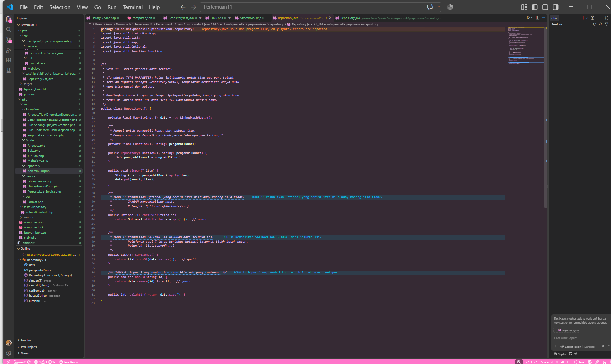

* **After** *(Kondisi akhir / Eksekusi berhasil)*: komentar `// ganti` sudah dihapus dan ketiga method memakai implementasi final.

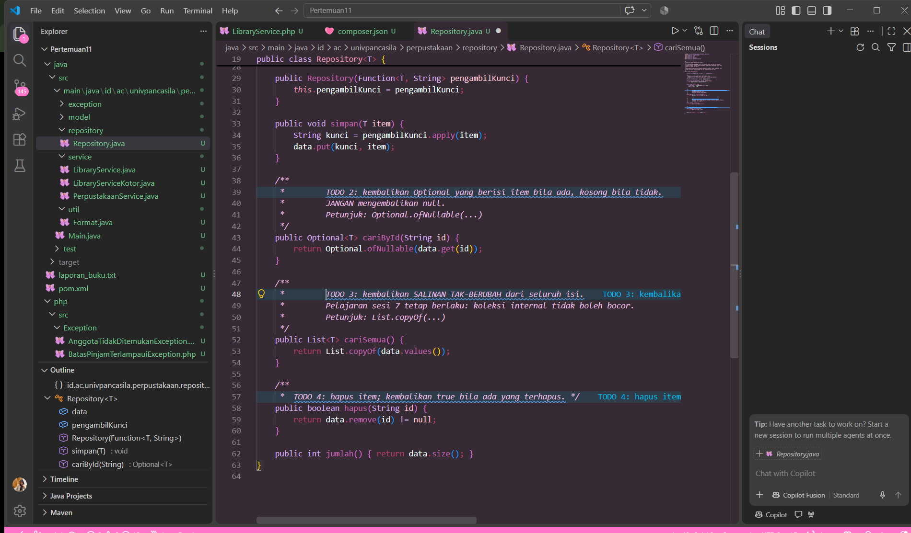

### 1.2. File: `RepositoryTest.java`
**Penjelasan Kode:**
> Berkas ini berisi unit test JUnit 5 untuk `Repository<T>` dan `LibraryService`. Karena tes yang dijalankan Maven hanya berkas bernama `*Test` di `src/test/java`, berkas ini diletakkan di `src/test/java/id/ac/univpancasila/perpustakaan/repository/`. Method `siapkan()` bertanda `@BeforeEach` sehingga setiap pengujian berangkat dari `Repository` yang bersih dan tidak saling memengaruhi. `record Buku(String isbn, String judul)` dipakai sebagai objek sederhana yang diuji.
>
> Total ada **12 pengujian**:
> - **TODO 1 - `simpanLaluTemukan`**: item yang disimpan dapat ditemukan lagi (`assertTrue(isPresent())` dan `assertEquals` pada judul).
> - **`cariYangTidakAda`**: ID yang tidak ada mengembalikan `Optional` kosong.
> - **TODO 3 - `hapusItem`**: item yang dihapus mengembalikan `true` dan tidak dapat ditemukan lagi.
> - **TODO 4 - `repositoryKosong`**: repository baru berisi 0 item.
> - **TODO 5 - `koleksiTidakBocor`**: `assertThrows(UnsupportedOperationException.class, ...)` memastikan hasil `cariSemua()` tidak bisa diubah dari luar.
> - **TODO 6** (pengujian tambahan dari daftar skenario sesi 10):
>   - `simpanKunciSamaMenimpaData`: kunci yang sama menimpa data lama dan jumlah tetap 1.
>   - `hapusItemTidakAdaMengembalikanFalse`: menghapus ID yang tidak ada mengembalikan `false`.
>   - `exceptionPinjamBukuTidakAda`: melempar `BukuTidakDitemukanException`.
>   - `exceptionPinjamAnggotaTidakAda`: melempar `AnggotaTidakDitemukanException`.
>   - `pinjamBerhasilMengurangiStok` (Skenario 1): peminjaman berhasil dan stok berkurang satu.
>   - `exceptionPinjamStokHabis` (Skenario 2): melempar `BukuSedangDipinjamException`.
>   - `exceptionBatasPinjamTerlampaui` (Skenario 5): melempar `BatasPinjamTerlampauiException` setelah `BATAS_PINJAM` tercapai.

**Bukti Eksekusi (Screenshot):**
* **Before** *(Kondisi awal / Kesalahan kompilasi)*: penanda TODO 1-6 masih terlihat di kode dan VS Code menampilkan peringatan *non-project file*.

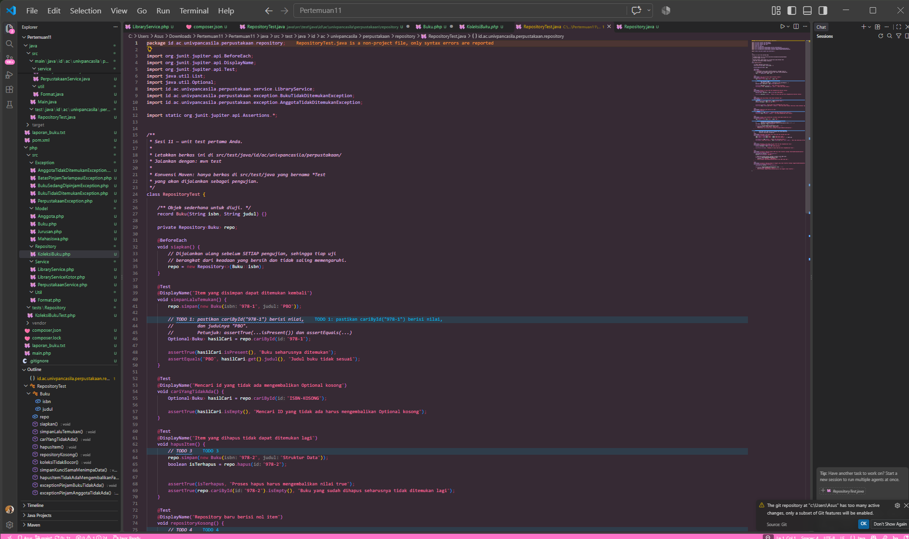

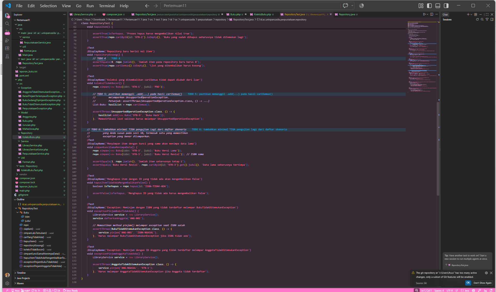

* **After** *(Kondisi akhir / Eksekusi berhasil)*: seluruh TODO sudah dikerjakan dan 12 pengujian lengkap. Hasil `mvn test`: `Tests run: 12, Failures: 0, Errors: 0, Skipped: 0`.

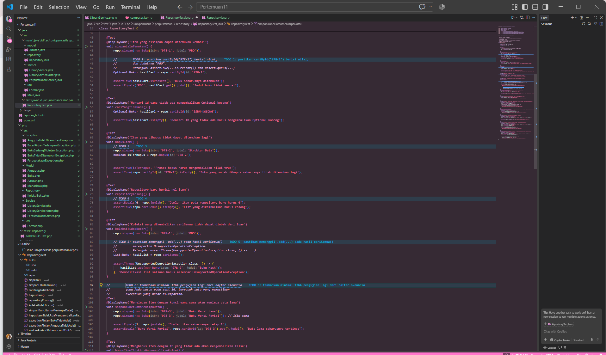

### 1.3. File: `pom.xml`
**Penjelasan Kode:**
> `pom.xml` adalah berkas konfigurasi Maven untuk proyek `id.ac.univpancasila:perpustakaan:1.0.0` dengan Java 21. Isi yang relevan untuk sesi 11:
> - Dependensi `org.junit.jupiter:junit-jupiter:5.11.3` dengan `scope` `test`, supaya JUnit hanya dipakai saat pengujian.
> - `maven-surefire-plugin` (3.5.2) agar pengujian dapat dijalankan dengan `mvn test`.
> - `exec-maven-plugin` (3.5.0) dengan `mainClass` `id.ac.univpancasila.perpustakaan.Main` agar program dapat dijalankan dengan `mvn exec:java`.
> - Dependensi `net.datafaker:datafaker:2.1.0` bawaan sesi sebelumnya.

**Bukti Eksekusi (Screenshot):**
* **Before** *(Kondisi awal / Kesalahan kompilasi)*: berkas belum dirapikan (tanpa indentasi) sehingga sulit dibaca.

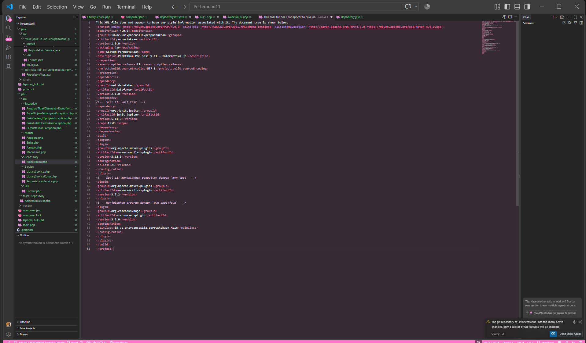

* **After** *(Kondisi akhir / Eksekusi berhasil)*: berkas sudah dirapikan dan terbaca sebagai XML yang valid, lengkap dengan dependensi JUnit dan plugin surefire.

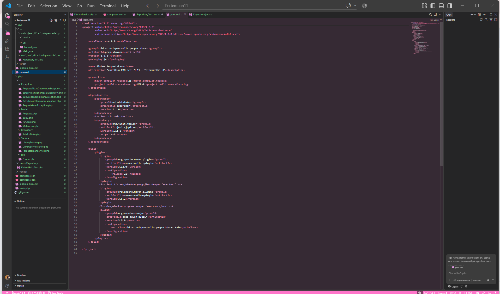

### Output
**Output Program:**

Program utama `Main.java` dijalankan dengan `mvn exec:java`. Contoh alurnya: menambah buku (ISBN `978-602-424-694-5`, *Laut Bercerita*, 40 eksemplar), mendaftarkan anggota `4525210092`, lalu meminjam buku. Pinjam dengan ISBN kosong ditolak dengan pesan *Error Domain*, sedangkan ISBN yang benar berhasil (`Peminjaman Berhasil!`).


Saat keluar dari program, laporan diekspor ke `laporan_buku.txt`:

```text
==========================================================================
                    LAPORAN DAFTAR BUKU PERPUSTAKAAN
==========================================================================
ISBN         | JUDUL BUKU                          | STOK     | STATUS
--------------------------------------------------------------------------
978-602-424-694-5 | Laut Bercerita                      | 39       | Tersedia
==========================================================================
```

---

## 2. Implementasi PHP

### 2.1. File: `Buku.php`
**Penjelasan Kode:**
> Berkas ini berisi dua kelas di namespace `Perpustakaan\Model`, yaitu `Bab` dan `Buku`. Bagian yang diselesaikan:
> - **TODO 1 - `Bab`**: constructor memakai *constructor promotion* dengan properti `private readonly int $nomor` dan `private readonly string $judul`, sehingga objek `Bab` tidak bisa diubah setelah dibuat. PHP tidak punya *nested class* seperti Java, jadi aturan bahwa `Bab` hanya dibuat dari dalam `Buku` dijaga lewat konvensi.
> - **TODO 2 - constructor `Buku`**: menolak jumlah eksemplar negatif dengan melempar `Error`.
> - **TODO 3 - `tambahBab(int $nomor, string $judulBab)`**: satu-satunya cara `Bab` dibuat. Parameternya nomor dan judul, bukan objek `Bab`.
> - **TODO 4 - `kurangiStok()`**: melempar `Error` bila stok sudah 0, selain itu stok dikurangi satu.
>
> `getBab()` mengembalikan array secara *by-value*, jadi pemanggil hanya mendapat salinan array. Namun objek `Bab` di dalamnya tetap berbagi referensi, itulah alasan `Bab` dibuat `readonly`.

**Bukti Eksekusi (Screenshot):**
* **Before** *(Kondisi awal / Galat logika)*: penanda TODO 1-4 masih ada di kode, dan penanda `TODO 2` pada constructor `Buku` ikut tersorot.

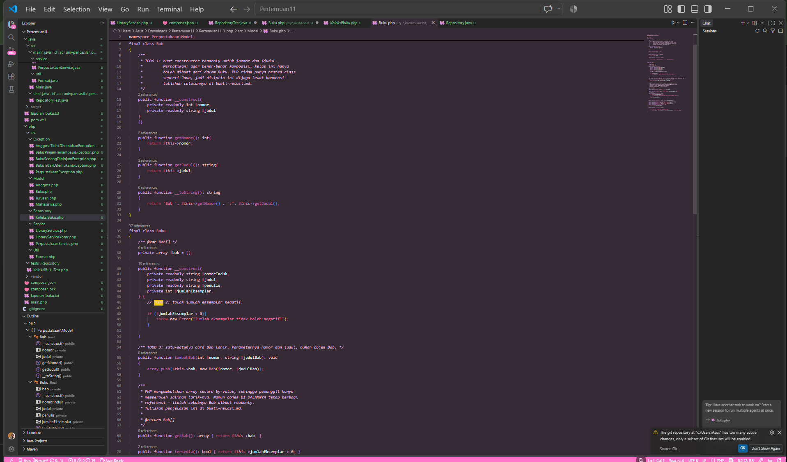

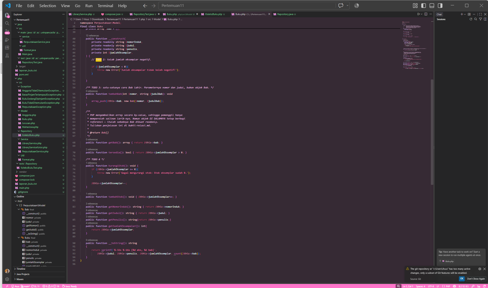

* **After** *(Kondisi akhir / Eksekusi berhasil)*: penanda diganti `[SELESAI]` karena keempat TODO sudah diimplementasikan.

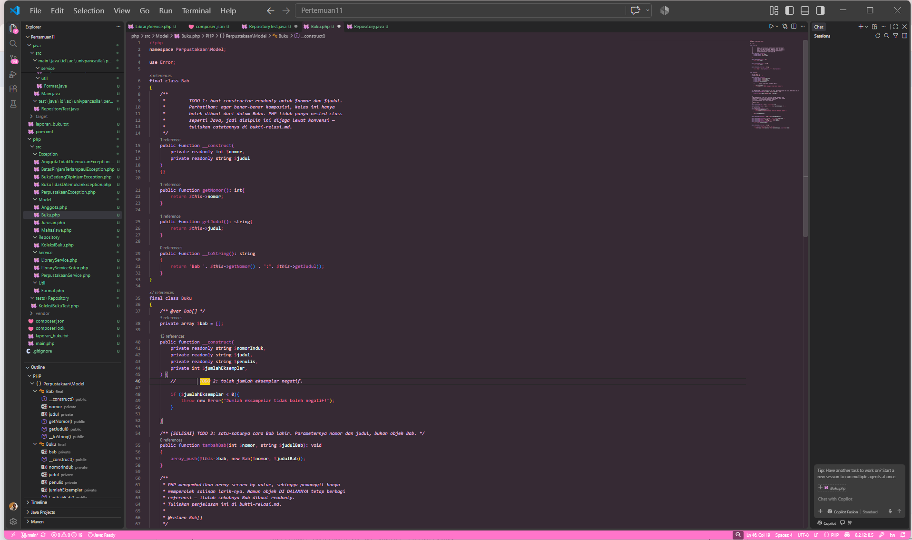

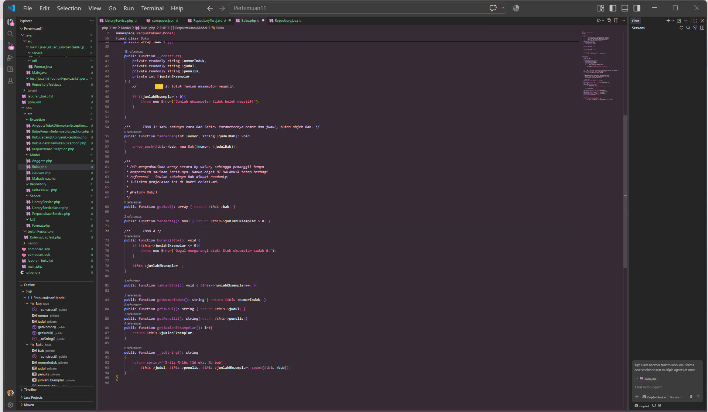

### 2.2. File: `KoleksiBuku.php`
**Penjelasan Kode:**
> `KoleksiBuku` adalah padanan `Repository<Buku>` di Java. PHP tidak punya generics sungguhan, sehingga kelas ini dibuat khusus untuk `Buku` dan tipenya dijaga lewat *type hint* pada parameter. Kelas ini `implements Countable` agar `count($koleksi)` dan `assertCount()` dapat dipakai. Data disimpan dalam array `$data` dengan kunci nomor induk (ISBN).
> - `simpan(Buku $buku)`: ISBN yang sama menimpa data lama.
> - `cariByIsbn(string $isbn): ?Buku`: mengembalikan `null` (bukan exception) bila tidak ada, setara `Optional` kosong di Java.
> - `hapus(string $isbn): bool`: `true` bila ada yang terhapus.
> - `semua(): array`: mengembalikan `array_values($this->data)`. Array PHP dikembalikan by-value, jadi koleksi internal tidak bocor.
> - `count(): int`: jumlah item.
> - Operasi fungsional yang menerima `callable` (setara `Function`/`Predicate` di Java): `filter()` mengembalikan `KoleksiBuku` baru sehingga bisa dirantai, `map()` mengubah tiap buku menjadi nilai lain, `kelompokkan()` mengelompokkan berdasarkan kunci, dan `jumlahkan()` menjumlahkan nilai numerik.

**Bukti Eksekusi (Screenshot):**
* **Before** *(Kondisi awal / Galat logika)*:

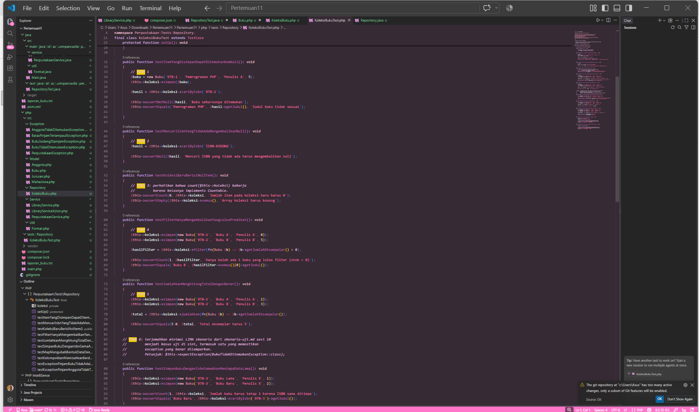

* **After** *(Kondisi akhir / Eksekusi berhasil)*:

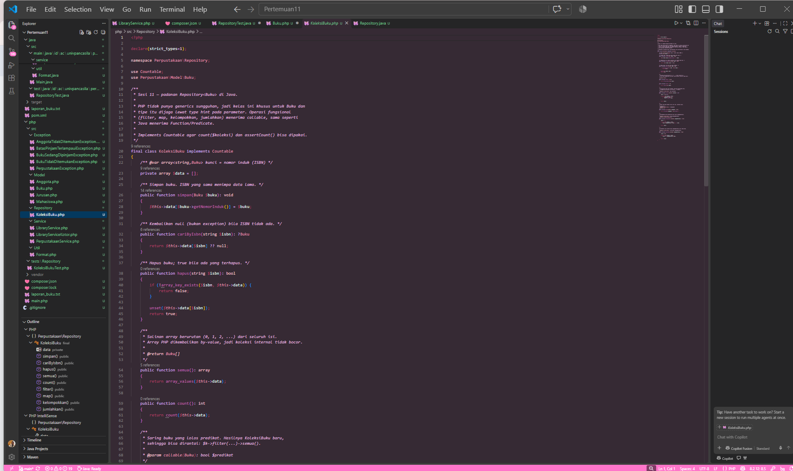

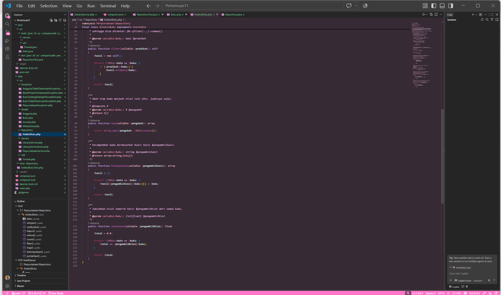

### 2.3. File: `KoleksiBukuTest.php`
**Penjelasan Kode:**
> Berkas ini berisi unit test PHPUnit di `tests/Repository/` dengan namespace `Perpustakaan\Tests\Repository`, dipetakan lewat `autoload-dev` pada `composer.json`. Method `setUp()` dijalankan sebelum setiap pengujian (setara `@BeforeEach`). Total ada **13 pengujian**:
> - **TODO 1**: `testItemYangDisimpanDapatDitemukanKembali` memakai `assertNotNull` dan `assertEquals`.
> - **TODO 2**: `testMencariIsbnYangTidakAdaMengembalikanNull` memakai `assertNull`.
> - **TODO 3**: `testKoleksiBaruBerisiNolItem` memakai `assertCount(0, ...)` yang bekerja karena `KoleksiBuku` implements `Countable`.
> - **TODO 4**: `testFilterHanyaMengembalikanYangLolosPredikat`.
> - **TODO 5**: `testJumlahkanMenghitungTotalDenganBenar`.
> - **TODO 6** (diterjemahkan dari `skenario-uji.md` sesi 10):
>   - `testSimpanBukuDenganIsbnSamaAkanMenimpaDataLama`.
>   - `testMapMengubahBentukDataDenganBenar`.
>   - `testKelompokkanMemisahkanBerdasarkanPenulis`.
>   - `testExceptionPinjamBukuTidakAda`: `expectException(BukuTidakDitemukanException::class)`.
>   - `testExceptionPinjamAnggotaTidakTerdaftar`: `expectException(AnggotaTidakDitemukanException::class)`.
>   - `testPinjamBerhasilMengurangiStok` (Skenario 1).
>   - `testExceptionPinjamStokHabis` (Skenario 2): `BukuSedangDipinjamException`.
>   - `testExceptionBatasPinjamTerlampaui` (Skenario 5): `BatasPinjamTerlampauiException`.
>
> Pengujian dijalankan dengan `./vendor/bin/phpunit tests`.

**Bukti Eksekusi (Screenshot):**
* **Before** *(Kondisi awal / Galat logika)*:


* **After** *(Kondisi akhir / Eksekusi berhasil)*:


### Output
**Output Program:**

Program `main.php` dijalankan dengan `php main.php`, lalu laporan diekspor ke `laporan_buku.txt`:


```text
==========================================================================
                    LAPORAN DAFTAR BUKU PERPUSTAKAAN
==========================================================================
ISBN         | JUDUL BUKU                          | STOK     | STATUS
--------------------------------------------------------------------------
111          | Laskar Pelangi                      | 0        | Tidak Tersedia
222          | Bumi Manusia                        | 3        | Tersedia
==========================================================================
```

---

## 3. Kesimpulan
> Pada pertemuan 11 ini saya membuat kelas penyimpanan generik `Repository<T>` di Java dan padanannya `KoleksiBuku` di PHP, lalu mengujinya dengan unit test otomatis.
>
> - **Generics**: di Java, `Repository<T>` bekerja untuk tipe apa pun karena kunci tiap item diambil lewat `Function<T, String>`, dan kompilator menjaga keamanan tipenya. PHP tidak punya generics sungguhan, sehingga `KoleksiBuku` dibuat khusus untuk `Buku` dan dijaga lewat *type hint*.
> - **Pencarian aman**: Java memakai `Optional` untuk hasil yang mungkin kosong, sedangkan PHP mengembalikan `?Buku` (`null`). Keduanya menghindari exception untuk kasus "data tidak ditemukan".
> - **Koleksi tidak bocor**: Java memakai `List.copyOf(...)` yang tak-berubah (terbukti lewat `UnsupportedOperationException`), sedangkan PHP mengandalkan array yang dikembalikan by-value, dengan `Bab` dibuat `readonly` agar objek di dalamnya aman.
> - **Unit test**: JUnit 5 (`@BeforeEach`, `assertThrows`) dan PHPUnit (`setUp`, `expectException`) membuat setiap pengujian berangkat dari kondisi bersih. Skenario dari sesi 10 (stok habis, batas pinjam, buku atau anggota tidak ditemukan) berhasil diterjemahkan menjadi kasus uji.
> - **Hasil**: seluruh **12 pengujian JUnit** dan **13 pengujian PHPUnit** lulus tanpa kegagalan, sehingga implementasi `Repository`/`KoleksiBuku` dan alur peminjaman pada `LibraryService` terbukti sesuai skenario yang dirancang.
