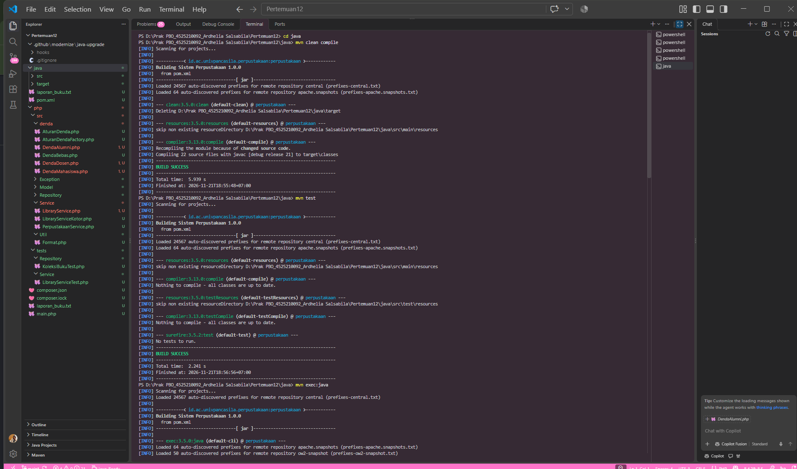
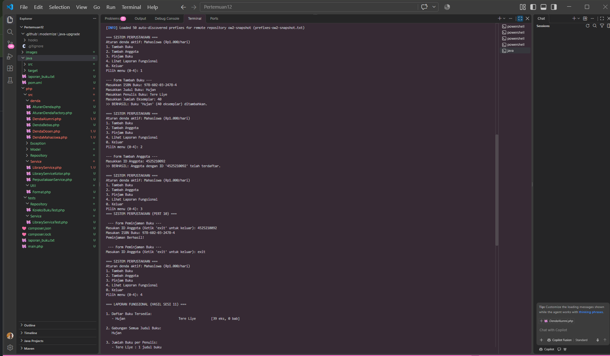
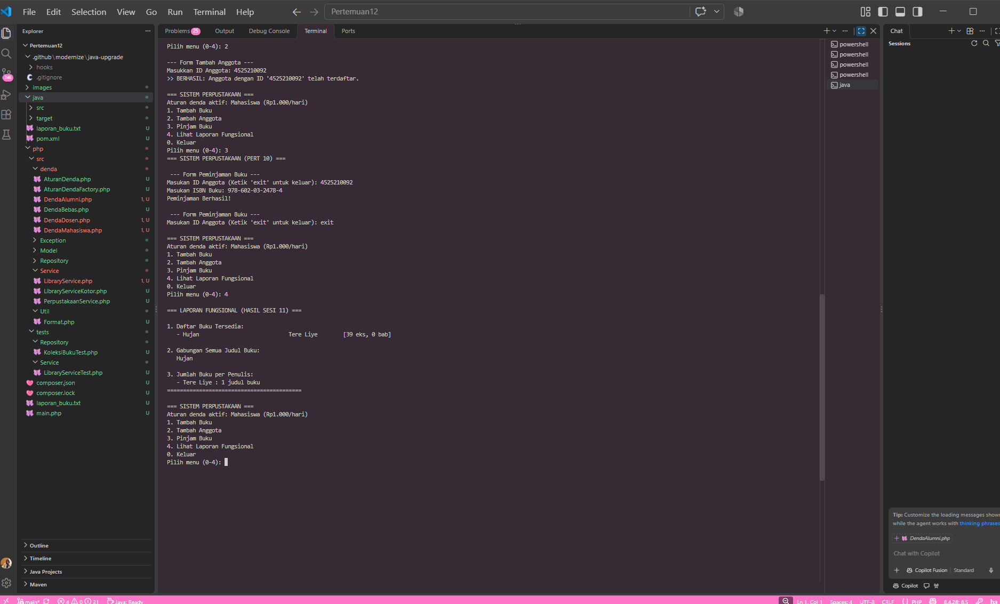
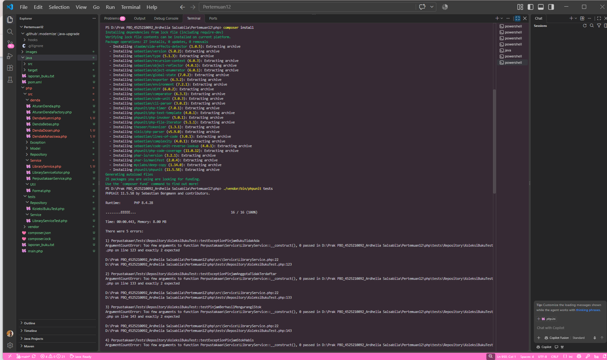
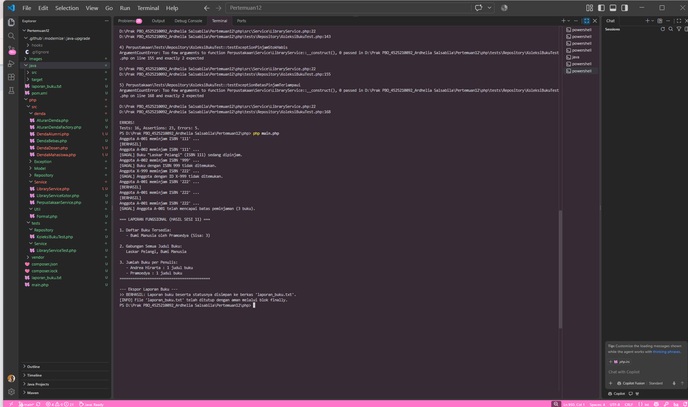

# LAPORAN PRAKTIKUM PEMROGRAMAN BERBASIS OBJEK

| Informasi Praktikan | Keterangan |
| :--- | :--- |
| **Nama** | Ardhelia Salsabila |
| **NPM** | 4525210092 |
| **Kelas** | A |
| **Mata Kuliah** | Pemrograman Berbasis Objek (PBO) |
| **Pertemuan** | 12 - Prinsip SOLID dan Design Pattern Dasar |
| **Tanggal** | 21 November 2026 |

---

## Gambaran Umum

Pertemuan 12 melanjutkan Sistem Perpustakaan dari pertemuan sebelumnya (exception, generics, dan operasi fungsional). Pada pertemuan ini `LibraryService` dirancang ulang agar **tidak lagi bergantung pada kelas konkret**. Ada tiga ide utama:

| Konsep | Peran di proyek |
| :--- | :--- |
| **Repository Pattern** | `BookRepository` menyembunyikan *cara* buku disimpan dari logika bisnis. |
| **Strategy Pattern** | `AturanDenda` membuat perhitungan denda dapat diganti-ganti sesuai jenis anggota. |
| **Factory + Dependency Injection** | `AturanDendaFactory` memilih strategi, lalu `LibraryService` menerima dependensinya lewat constructor. |

Struktur proyek (Java dan PHP dibuat paralel):

```
Pertemuan12/
├── java/   (Maven, Java 21)
│   └── src/main/java/id/ac/univpancasila/perpustakaan/
│       ├── Main.java
│       ├── denda/        AturanDenda, DendaMahasiswa, DendaDosen, DendaAlumni, DendaBebas, AturanDendaFactory
│       ├── repository/   BookRepository, InMemoryBookRepository, Repository<T>
│       ├── service/      LibraryService, PerpustakaanService, LibraryServiceKotor
│       ├── model/        Buku, Anggota, Jurusan
│       └── exception/    PerpustakaanException + 4 turunannya
├── php/    (Composer, PHP 8.2+)
│   ├── main.php
│   └── src/  denda, Repository, Service, Model, Exception, Util
└── images/ (bukti eksekusi)
```

---

## 1. Implementasi Java

### 1.1. File: `BookRepository.java` dan `InMemoryBookRepository.java`
**Penjelasan Kode:**
> `BookRepository` adalah **interface** yang mendefinisikan kontrak penyimpanan buku: `simpan(Buku)`, `cariByIsbn(String)`, `cariSemua()`, dan `kurangiStok(Buku)`. Pencarian mengembalikan `Optional<Buku>` sehingga pemanggil dipaksa menangani kasus "buku tidak ada" tanpa menerima `null`.
>
> `InMemoryBookRepository` adalah implementasinya. Data disimpan dalam `LinkedHashMap<String, Buku>` dengan ISBN sebagai kunci agar urutan input tetap terjaga. `cariSemua()` mengembalikan `Collections.unmodifiableList(new ArrayList<>(...))` sehingga koleksi internal tidak bisa diubah dari luar. Nanti, penyimpanan dapat diganti ke database tanpa menyentuh `LibraryService`, cukup dengan membuat implementasi `BookRepository` yang baru.

### 1.2. File: `AturanDenda.java`, `DendaMahasiswa.java`, `DendaDosen.java`, `DendaAlumni.java`, `DendaBebas.java`
**Penjelasan Kode:**
> `AturanDenda` adalah interface **Strategy** dengan dua method: `hitung(int hariTerlambat)` dan `nama()`. Setiap jenis anggota punya kelas strategi sendiri:
>
> | Kelas | Tarif per hari |
> | :--- | :--- |
> | `DendaMahasiswa` | Rp1.000 |
> | `DendaDosen` | Rp500 |
> | `DendaAlumni` | Rp750 |
> | `DendaBebas` (kehormatan) | Rp0 |
>
> Semua memakai `Math.max(0, hariTerlambat)` sehingga hari negatif dianggap nol. `DendaAlumni` ditambahkan belakangan tanpa mengubah satu baris pun di `LibraryService`. Ini bukti penerapan **Open-Closed Principle**: terbuka untuk perluasan, tertutup untuk modifikasi.

### 1.3. File: `AturanDendaFactory.java`
**Penjelasan Kode:**
> Kelas utilitas `final` dengan constructor `private` dan satu method statis `untuk(String jenisAnggota)`. Method ini memilih strategi dengan `switch` pada teks yang sudah di-`trim()` dan di-`toLowerCase()`, misalnya `"mahasiswa"` menghasilkan `DendaMahasiswa`, sedangkan `"kehormatan"` dan `"bebas"` sama-sama menghasilkan `DendaBebas`. Input `null` atau jenis yang tidak dikenal menghasilkan `IllegalArgumentException`. Dengan factory, kode pemanggil (`Main`) tidak perlu mengetahui kelas konkret strateginya.

### 1.4. File: `LibraryService.java`
**Penjelasan Kode:**
> Inti dari **Dependency Injection**. Constructor menerima `BookRepository` dan `AturanDenda` dari luar, dan tidak ada `new` kelas konkret di dalam service (keduanya ditolak dengan `IllegalArgumentException` bila `null`). Service hanya bergantung pada abstraksi, sesuai **Dependency Inversion Principle**.
>
> Method `pinjam()` ditulis dengan **guard clause** (bukan `if` bersarang empat tingkat seperti pada `LibraryServiceKotor.java`). Setiap pelanggaran aturan langsung melempar exception khusus:
>
> | Urutan pengecekan | Exception |
> | :--- | :--- |
> | Anggota belum terdaftar | `AnggotaTidakDitemukanException` |
> | ISBN tidak ada | `BukuTidakDitemukanException` |
> | Stok habis | `BukuSedangDipinjamException` |
> | Pinjaman sudah 3 buku | `BatasPinjamTerlampauiException` |
>
> Method fungsional seperti `getBukuTersedia()` (`filter`), `getSemuaJudulDigabung()` (`map` + `joining`), dan `getJumlahBukuPerPenulis()` (`groupingBy` + `counting`) memakai Stream API dari pertemuan 11.

### 1.5. File: `PerpustakaanService.java`
**Penjelasan Kode:**
> Lapisan antarmuka konsol. Berisi `tambahBuku()`, `tambahAnggota()`, `pinjamBuku()`, dan `tampilkanLaporanFungsional()`. Pada `pinjamBuku()`, seluruh kegagalan domain ditangkap lewat satu `catch (PerpustakaanException e)`, lalu `instanceof` pattern matching dipakai untuk menampilkan detail spesifik (ISBN, ID anggota, judul, atau batas). `catch (Exception e)` terpisah menangani kesalahan tak terduga. Input kosong dan angka eksemplar yang tidak valid juga divalidasi.

### 1.6. File: `Main.java`
**Penjelasan Kode:**
> Titik masuk program sekaligus tempat **manual Dependency Injection**: `InMemoryBookRepository` dibuat, `AturanDendaFactory.untuk("mahasiswa")` dipanggil, lalu keduanya disuntikkan ke `new LibraryService(repo, aturanDenda)`. Program menampilkan menu interaktif (1. Tambah Buku, 2. Tambah Anggota, 3. Pinjam Buku, 4. Laporan Fungsional, 0. Keluar). Saat keluar, `eksporLaporan()` menulis `laporan_buku.txt` memakai `try-with-resources` agar `PrintWriter` ditutup otomatis.

### Output
**Build dan menjalankan pengujian Maven** (`mvn clean compile` dan `mvn test`):


**Menjalankan program** (`mvn exec:java`): tambah buku, tambah anggota, dan pinjam buku:


**Laporan fungsional** (menu 4):


---

## 2. Implementasi PHP

### 2.1. File: `BookRepository.php` dan `InMemoryBookRepository.php`
**Penjelasan Kode:**
> Padanan Java di PHP. `BookRepository` adalah interface dengan method bertipe ketat (`declare(strict_types=1)`): `simpan(Buku): void`, `cariByIsbn(string): ?Buku`, `cariSemua(): array`, dan `kurangiStok(Buku): void`. PHP tidak punya `Optional`, jadi pencarian mengembalikan tipe *nullable* `?Buku`. `InMemoryBookRepository` menyimpan data pada array asosiatif dengan ISBN sebagai kunci, dan `cariByIsbn()` memakai operator `?? null`.

### 2.2. File: `AturanDenda.php`, `DendaMahasiswa.php`, `DendaDosen.php`, `DendaAlumni.php`, `DendaBebas.php`
**Penjelasan Kode:**
> Penerapan **Strategy Pattern** di PHP. `AturanDenda` adalah interface dengan `hitung(int): float` dan `nama(): string`. Keempat implementasinya berupa `final class` dengan tarif memakai typed constant (`private const float TARIF_PER_HARI`): Mahasiswa Rp1.000, Dosen Rp500, Alumni Rp750, dan Kehormatan Rp0. Hari negatif dijaga dengan `max(0, $hariTerlambat)`.

### 2.3. File: `AturanDendaFactory.php`
**Penjelasan Kode:**
> `AturanDendaFactory::untuk(string $jenisAnggota)` memanfaatkan ekspresi `match` (fitur PHP 8) pada nilai yang sudah dinormalisasi dengan `strtolower(trim(...))`. Jenis yang tidak dikenal memicu `InvalidArgumentException` lewat `default => throw ...`. Hasilnya lebih ringkas dibanding `switch` di versi Java.

### 2.4. File: `LibraryService.php`
**Penjelasan Kode:**
> Menggunakan **constructor property promotion** dengan `private readonly`, sehingga `BookRepository` dan `AturanDenda` disuntikkan lewat constructor dan tidak dapat diubah setelahnya. Method `pinjam()` memakai guard clause yang melempar `AnggotaTidakDitemukanException`, `BukuTidakDitemukanException`, `BukuSedangDipinjamException`, atau `BatasPinjamTerlampauiException`. Operasi fungsional memakai `array_filter`, `array_map`, dan `implode`. Semua exception diturunkan dari `PerpustakaanException` sehingga dapat ditangkap sekaligus.

### 2.5. File: `main.php`
**Penjelasan Kode:**
> Titik masuk program PHP yang juga merakit dependensi secara manual: `InMemoryBookRepository` dan `AturanDendaFactory::untuk('mahasiswa')` disuntikkan ke `LibraryService`. Skrip menyiapkan dua buku (Laskar Pelangi, 1 eksemplar; Bumi Manusia, 5 eksemplar) dan dua anggota, lalu menjalankan **7 skenario peminjaman** yang mencakup kelima kasus pada `skenario-uji.md` (berhasil, stok habis, ISBN tidak ada, anggota belum terdaftar, batas pinjam tercapai). Setelah itu laporan fungsional ditampilkan dan `createReport()` menulis `laporan_buku.txt` dengan blok `try ... finally` agar file selalu ditutup dengan `fclose()`.

### Output
**Instalasi dependensi dan menjalankan PHPUnit** (`composer install` dan `./vendor/bin/phpunit tests`):


**Menjalankan `php main.php`**: 7 skenario peminjaman, laporan fungsional, dan ekspor laporan:


---

## 3. Kesimpulan

> Pada pertemuan 12, `LibraryService` berhasil direfaktor dari kelas yang terikat pada implementasi tertentu menjadi kelas yang hanya bergantung pada abstraksi, baik di Java maupun PHP.
>
> 1. **Repository Pattern** (`BookRepository`) memisahkan logika bisnis dari cara penyimpanan data, sehingga penyimpanan dapat diganti (misalnya ke database) atau diganti repository palsu saat pengujian, tanpa mengubah `LibraryService`.
> 2. **Strategy Pattern** (`AturanDenda`) menggantikan percabangan `if/else` berdasarkan jenis anggota dengan kelas-kelas terpisah. Penambahan `DendaAlumni` membuktikan **Open-Closed Principle**.
> 3. **Factory** (`AturanDendaFactory`) memusatkan pemilihan strategi, dan **Dependency Injection** lewat constructor membuat objek mudah dirakit dan diuji, sesuai **Dependency Inversion Principle**.
> 4. **Exception khusus** (turunan `PerpustakaanException`, bertipe *unchecked*) memberi tahu pemanggil alasan kegagalan, berbeda dengan versi `LibraryServiceKotor` yang hanya mengembalikan `false`.
>
> **Catatan:** pada PHPUnit, 5 dari 16 tes `KoleksiBukuTest` masih gagal (`Too few arguments to LibraryService::__construct()`). Tes tersebut berasal dari pertemuan 11 dan masih memanggil `new LibraryService()` tanpa argumen, padahal constructor kini mewajibkan `BookRepository` dan `AturanDenda`. Ini konsekuensi penerapan Dependency Injection dan perbaikannya cukup dengan menyuntikkan `InMemoryBookRepository` dan `DendaMahasiswa` pada tes tersebut. Pada Java, `mvn test` menampilkan "No tests to run" karena berkas tes berada di `src/test/Service` dan `src/test/repository`, bukan di struktur standar Maven `src/test/java`.
