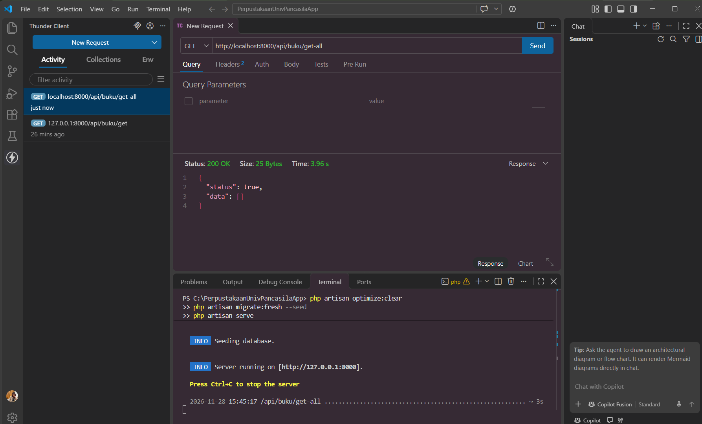
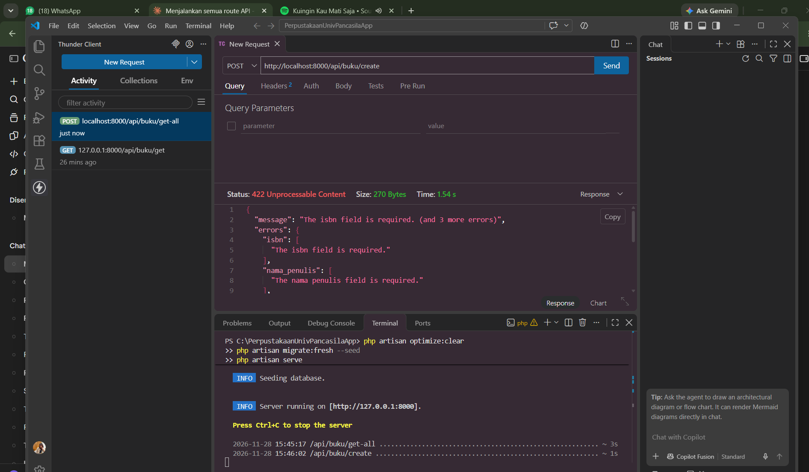
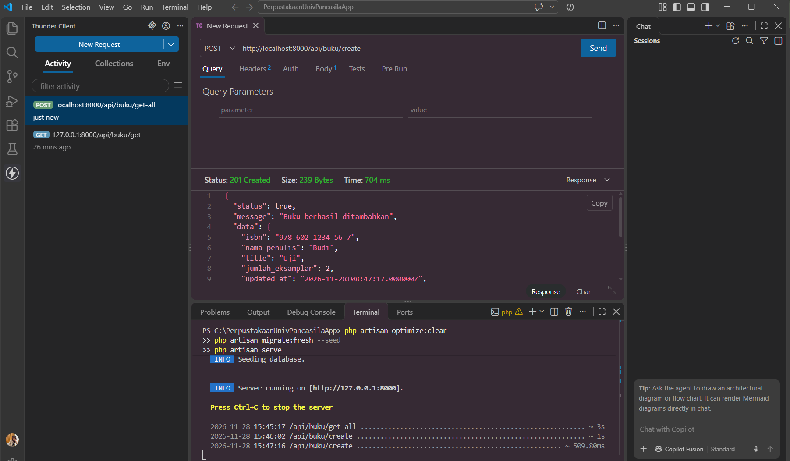
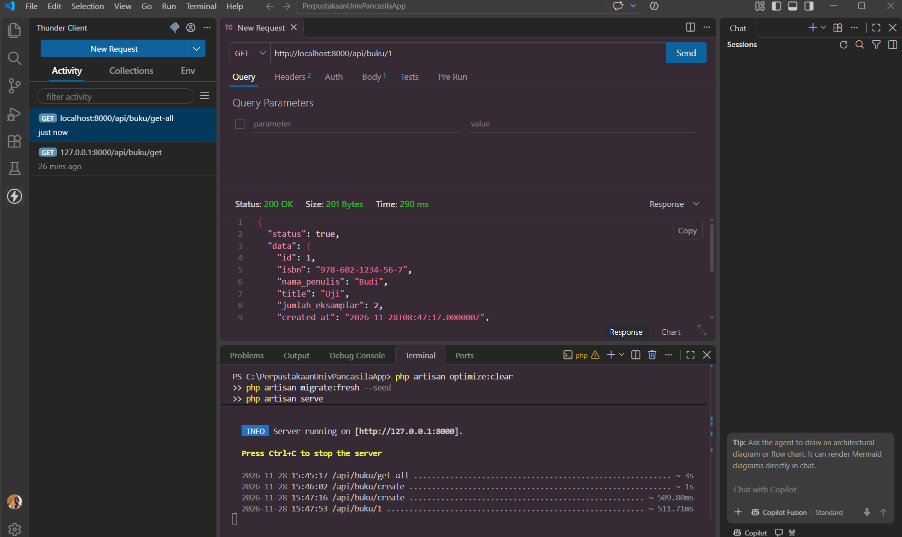
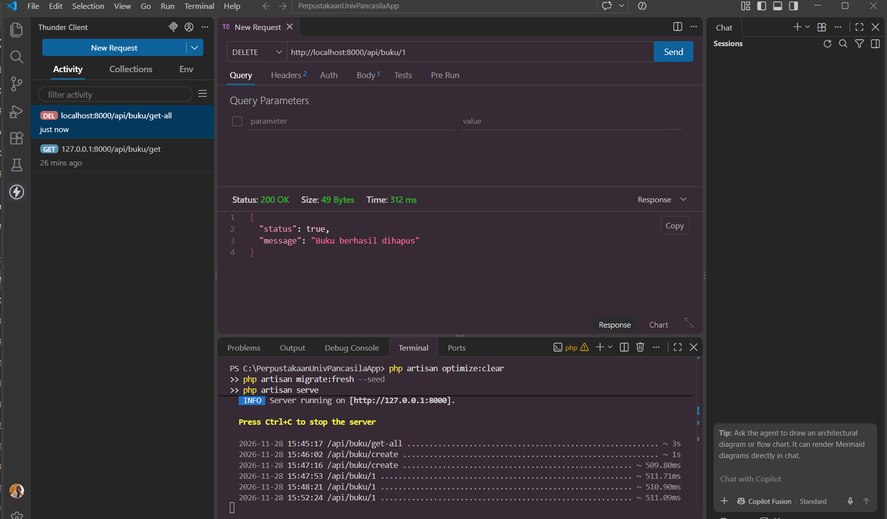

# LAPORAN PRAKTIKUM PEMROGRAMAN BERBASIS OBJEK

| Informasi Praktikan | Keterangan |
| :--- | :--- |
| **Nama** | Ardhelia Salsabila Al-Bahri |
| **NPM** | 4525210092 |
| **Kelas** | A |
| **Mata Kuliah** | Pemrograman Berbasis Objek (PBO) |
| **Pertemuan** | 13 - Menelusuri dan Memodifikasi Aplikasi Laravel  |
| **Tanggal** | 28 November 2026 |

---

## 1. Nama - NPM

**Ardhelia Salsabila Al-Bahri - 4525210092**

## 2. Kelas

**A**

---

## 3. Panduan Instalasi

Proyek: **PerpustakaanUnivPancasilaApp** (Laravel 13, PHP ^8.3, Laravel Sanctum).

### 3.1. Prasyarat
* PHP 8.3 atau lebih baru
* Composer
* Node.js & npm
* Database MySQL (misalnya lewat XAMPP / Laragon) atau SQLite
* VS Code + ekstensi Thunder Client (untuk menguji API)

### 3.2. Langkah Instalasi
1. Ekstrak `Pertemuan13.zip`, lalu masuk ke folder proyek:
   ```bash
   cd PerpustakaanUnivPancasilaApp
   ```
2. Install dependensi PHP:
   ```bash
   composer install
   ```
3. Install dependensi frontend:
   ```bash
   npm install
   ```
4. Salin file environment (lewati jika `.env` sudah ada), lalu generate app key:
   ```bash
   copy .env.example .env
   php artisan key:generate
   ```
5. Atur database di file `.env`.

   **Opsi A - MySQL** (sesuai konfigurasi yang saya pakai):
   ```env
   DB_CONNECTION=mysql
   DB_HOST=127.0.0.1
   DB_PORT=3306
   DB_DATABASE=Laravel
   DB_USERNAME=root
   DB_PASSWORD=
   ```
   Pastikan MySQL sudah menyala dan database `Laravel` sudah dibuat.

   **Opsi B - SQLite** (bawaan `.env.example`, tanpa setup tambahan):
   ```env
   DB_CONNECTION=sqlite
   ```
6. Jalankan migration dan seeder:
   ```bash
   php artisan migrate:fresh --seed
   ```

---

## 4. Panduan Menjalankan Laravel

1. Bersihkan cache (opsional, agar konfigurasi terbaru terbaca):
   ```bash
   php artisan optimize:clear
   ```
2. Reset database dan isi data awal:
   ```bash
   php artisan migrate:fresh --seed
   ```
3. Jalankan server pengembangan:
   ```bash
   php artisan serve
   ```
4. Server berjalan di **http://127.0.0.1:8000**. Seluruh endpoint API diakses dengan prefix `/api`, contoh: `http://localhost:8000/api/buku/get-all`.
5. Uji endpoint memakai Thunder Client (VS Code), Postman, atau `curl`.

---

## 5. Screenshot Route (`routes/api.php`)

**Isi file `routes/api.php`:**

```php
<?php

use App\Http\Controllers\BukuController;
use Illuminate\Support\Facades\Route;

Route::get('/buku/get-all', [BukuController::class, 'index']);
Route::post('/buku/create', [BukuController::class, 'store']);
Route::get('/buku/{id}', [BukuController::class, 'show']);
Route::put('/buku/{id}', [BukuController::class, 'update']);
Route::delete('/buku/{id}', [BukuController::class, 'destroy']);
```

**Screenshot `routes/api.php`:**


**Ringkasan route:**

| No | Method | URL | Method Controller | Fungsi |
| :-: | :--- | :--- | :--- | :--- |
| 1 | GET | `/api/buku/get-all` | `BukuController@index` | Menampilkan seluruh data buku |
| 2 | POST | `/api/buku/create` | `BukuController@store` | Menambah buku baru |
| 3 | GET | `/api/buku/{id}` | `BukuController@show` | Menampilkan detail satu buku |
| 4 | PUT | `/api/buku/{id}` | `BukuController@update` | Memperbarui data buku |
| 5 | DELETE | `/api/buku/{id}` | `BukuController@destroy` | Menghapus buku |

---

## 6. Percobaan Hasil API per Route

Pengujian dilakukan menggunakan **Thunder Client** pada server `http://localhost:8000`.

### 6.1. `GET /api/buku/get-all` - Ambil Semua Buku
**Penjelasan:** Mengambil seluruh data buku, diurutkan dari yang terbaru (`Buku::latest()->get()`). Pada percobaan ini database baru saja di-reset (`migrate:fresh --seed`), sehingga `data` masih kosong.

**Hasil:** Status `200 OK`



### 6.2. `POST /api/buku/create` - Tambah Buku (Validasi Gagal)
**Penjelasan:** Request dikirim tanpa body, sehingga validasi pada `store()` menolak request. Field `isbn`, `nama_penulis`, `title`, dan `jumlah_eksamplar` semuanya wajib diisi.

**Hasil:** Status `422 Unprocessable Content`, pesan `The isbn field is required. (and 3 more errors)`



### 6.3. `POST /api/buku/create` - Tambah Buku (Berhasil)
**Penjelasan:** Request dikirim dengan body JSON yang lengkap:

```json
{
  "isbn": "978-602-1234-56-7",
  "nama_penulis": "Budi",
  "title": "Uji",
  "jumlah_eksamplar": 2
}
```

**Hasil:** Status `201 Created`, pesan `Buku berhasil ditambahkan`



### 6.4. `GET /api/buku/{id}` - Detail Buku
**Penjelasan:** Mengambil satu buku berdasarkan `id` (`GET /api/buku/1`) memakai `Buku::findOrFail($id)`. Jika `id` tidak ditemukan, Laravel mengembalikan `404`.

**Hasil:** Status `200 OK`, data buku dengan `id = 1` tampil.



### 6.5. `PUT /api/buku/{id}` - Update Buku
**Penjelasan:** Memperbarui data buku dengan `id` tertentu (`PUT /api/buku/1`). Validasi pada `update()` mewajibkan `isbn`, `nama_penulis`, dan `jumlah_eksamplar`. Aturan `unique` pada `isbn` mengabaikan buku yang sedang diedit.

Contoh body:

```json
{
  "isbn": "978-602-1234-56-7",
  "nama_penulis": "Budi Santoso",
  "jumlah_eksamplar": 5
}
```

**Hasil:** Status `200 OK`, pesan `Data buku berhasil diperbarui`


### 6.6. `DELETE /api/buku/{id}` - Hapus Buku
**Penjelasan:** Menghapus buku dengan `id` tertentu (`DELETE /api/buku/1`) memakai `$buku->delete()`.

**Hasil:** Status `200 OK`, pesan `Buku berhasil dihapus`



---

## 7. Kesimpulan

Pada praktikum ini saya menelusuri struktur aplikasi Laravel **PerpustakaanUnivPancasilaApp**, mulai dari route di `routes/api.php`, `BukuController`, sampai model `Buku` dan migration tabel `buku`. Dari penelusuran tersebut terlihat bahwa setiap route API dipetakan ke satu method pada controller, dan model `Buku` yang mewarisi `Model` (Eloquent) menangani akses database tanpa perlu menulis query SQL manual. Aturan `$fillable` pada model dan validasi `$request->validate()` pada controller menjaga agar hanya data yang valid yang tersimpan. Hasil pengujian lima route (get-all, create, show, update, delete) di Thunder Client menunjukkan seluruh endpoint bekerja sesuai fungsinya, termasuk respons `422` saat validasi gagal dan `201` saat data berhasil dibuat.
