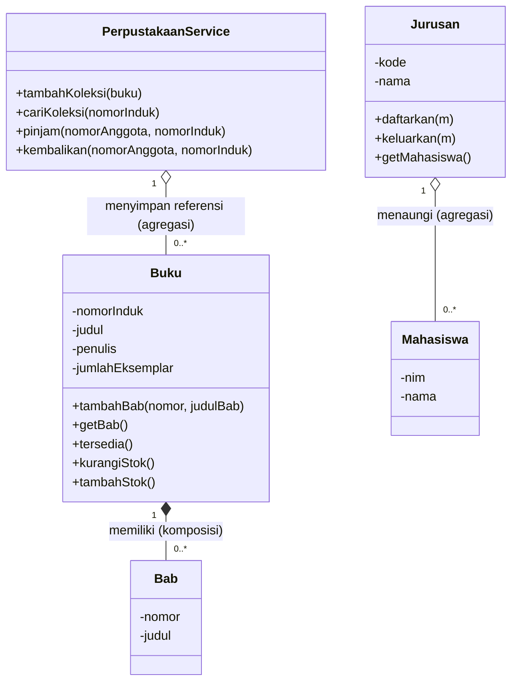

# Pertemuan 7 - Komposisi dan Agregasi (Sistem Perpustakaan)

**Mata kuliah:** Pemrograman Berorientasi Objek (PBO)
**Nama:** Ardhelia Sallsabila Al-Bahri | **NIM:** 4525210092
**Bahasa:** Java dan PHP

## Tujuan
Membedakan **komposisi** dan **agregasi** lewat studi kasus sistem perpustakaan, lalu merealisasikannya di dua bahasa (Java dan PHP) dan memodelkannya dengan class diagram UML.

## Struktur File
| File | Keterangan |
|------|------------|
| `deskripsi-kebutuhan.md` | Deskripsi kebutuhan sistem perpustakaan (dasar rancangan kelas, atribut, method, dan aturan bisnis). |
| `java/Main.java` | Program utama Java: demo komposisi, percobaan mengubah koleksi dari luar, dan demo agregasi. |
| `java/model/Buku.java` | Class `Buku` dengan nested class `Bab` (**komposisi**). |
| `java/model/Jurusan.java` | Class `Jurusan` dengan nested class `Mahasiswa` (**agregasi**). |
| `java/service/PerpustakaanService.java` | Kerangka lapisan layanan: `tambahKoleksi`, `cariKoleksi`, `pinjam`, `kembalikan`. |
| `php/relasi.php` | Class `Bab`, `Buku`, `Mahasiswa`, `Jurusan` versi PHP. |
| `php/main.php` | Program utama PHP: demo komposisi dan agregasi. |
| `uml/perpustakaan-kerangka.puml` | Class diagram PlantUML. |

## Cara Menjalankan
**Java** (dari folder `java`):
```bash
javac -d out $(find . -name "*.java")
java -cp out Main
```

**PHP** (dari folder `php`):
```bash
php main.php
```

## Screenshot Output
**Java**


**PHP**


## Class Diagram

Versi PlantUML-nya ada di `uml/perpustakaan-kerangka.puml`.

## Penjelasan

### Komposisi: `Buku` memiliki `Bab`
Bab itu seperti *halaman-halaman di dalam buku*: tidak punya arti kalau bukunya tidak ada, dan tidak pernah pindah ke buku lain. Agar benar-benar komposisi, ada tiga syarat dan semuanya dipenuhi di `Buku`:
1. **Tidak ada method/constructor yang menerima objek `Bab` dari luar.** `tambahBab(int nomor, String judulBab)` menerima *nomor dan judul*, bukan objek `Bab`.
2. **Objek `Bab` dibuat di dalam `Buku`** (`new Bab(nomor, judulBab)` di dalam `tambahBab`).
3. **Getter mengembalikan salinan yang tidak bisa diubah.** `getBab()` memakai `List.copyOf(...)`, jadi `buku.getBab().clear()` di `Main.java` **ditolak** (`UnsupportedOperationException`). Ibaratnya orang luar boleh *memfotokopi* daftar bab, tetapi tidak boleh mencoret aslinya.

Di Java, `Bab` adalah **nested class** dengan **constructor `private`**, sehingga hanya `Buku` yang bisa membuatnya.

### Agregasi: `Jurusan` menaungi `Mahasiswa`
Jurusan itu seperti *kelompok belajar*: anggotanya datang dari luar, dan kalau seseorang keluar dari kelompok, orangnya tetap ada. Pada `Jurusan`:
- `Mahasiswa` punya **constructor `public`** dan dibuat **di luar** `Jurusan`, lalu dimasukkan lewat `daftarkan(m)`.
- `keluarkan(m)` hanya melepaskan referensi. Di output terlihat `Budi tetap ada sebagai objek`, padahal jumlah mahasiswa jurusan sudah berkurang dari 2 menjadi 1.

### Perbandingan Java dan PHP
| Aspek | Java | PHP |
|-------|------|-----|
| Menjaga `Bab` hanya dibuat oleh `Buku` | Nested class + constructor `private` (dipaksa compiler). | PHP tidak punya nested class, jadi dijaga lewat **konvensi**: `Bab` hanya dibuat di `Buku::tambahBab()`. |
| Data `Bab` tidak bisa diubah | Field `final`. | Property `private readonly`. |
| `getBab()` | `List.copyOf()` (salinan tak-berubah). | Array dikembalikan *by-value* (salinan array), tetapi **objek di dalamnya tetap berbagi referensi**. Karena itu `Bab` dibuat `readonly` agar tidak bisa dimodifikasi dari luar. |
| Stok negatif | `IllegalArgumentException` di constructor. | `Error` dilempar di constructor jika `jumlahEksemplar < 0`. |

### Lapisan Layanan (`PerpustakaanService`)
`PerpustakaanService` menyimpan daftar `Buku` sebagai **agregasi** (buku tetap ada walau layanan dihapus). Pada pertemuan ini baru kerangkanya: `tambahKoleksi()`, `cariKoleksi()` (mencari berdasarkan nomor induk), serta `pinjam()` dan `kembalikan()` yang aturan bisnisnya akan disempurnakan di pertemuan berikutnya.
