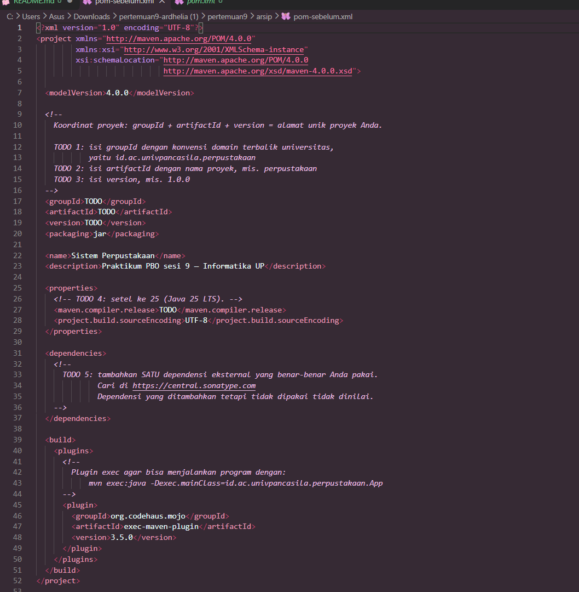
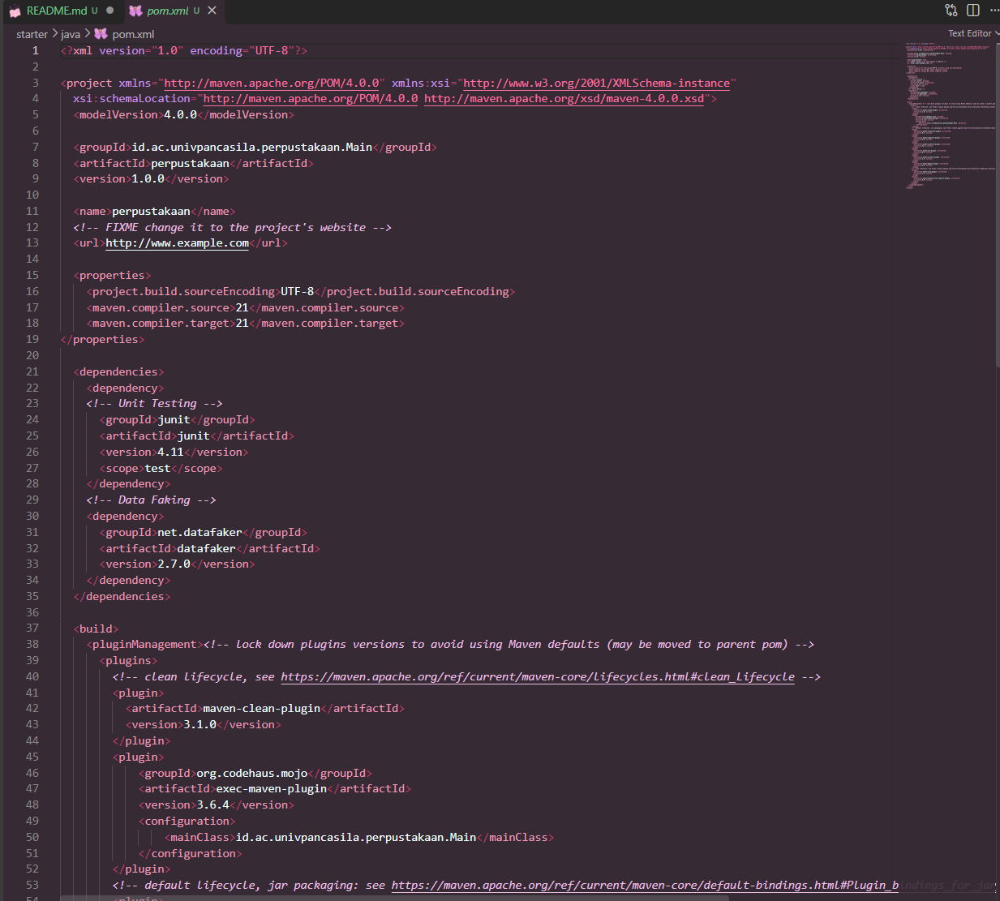
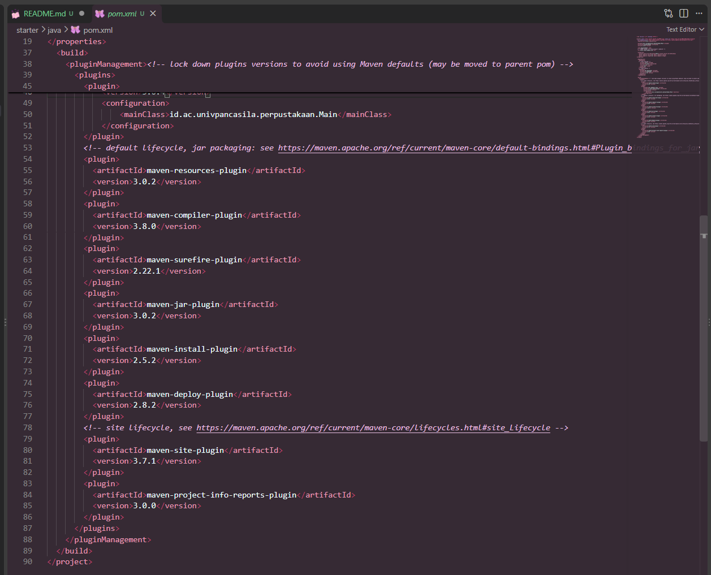
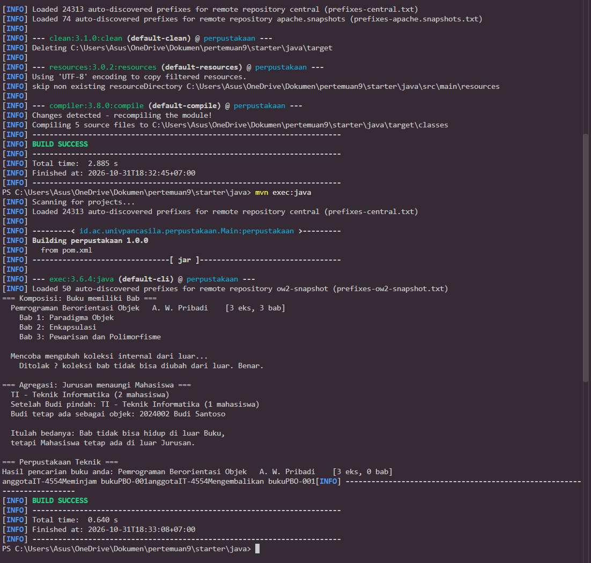

# LAPORAN PRAKTIKUM PEMROGRAMAN BERBASIS OBJEK

| Informasi Praktikan | Keterangan |
|---|---|
| **Nama** | Ardhelia Sallsabila Al-Bahri |
| **NPM** | 4525210092 |
| **Kelas** | A |
| **Mata Kuliah** | Pemrograman Berbasis Objek (PBO) |
| **Pertemuan** | [09] - [Package, Namespace, dan Build Tool] |
| **Tanggal** | [31-10-2026] |


## Struktur Proyek dan Aturan Package (Java)

Struktur folder mengikuti struktur baku Maven pada `struktur.txt`:

```
starter/java/
├── pom.xml
├── src/
│   ├── main/
│   │   ├── java/id/ac/univpancasila/perpustakaan/
│   │   │   ├── App.java                 (titik masuk, dari Main.java sesi 7)
│   │   │   ├── model/    Buku.java, Jurusan.java (memuat Jurusan.Mahasiswa), Anggota.java
│   │   │   ├── service/  PerpustakaanService.java
│   │   │   └── util/     Format.java
│   │   └── resources/
│   └── test/java/        (dipakai sesi 11)
└── target/               (hasil kompilasi, tidak di-commit)
```

Aturan yang wajib dipatuhi: baris `package` di setiap berkas harus sama persis dengan jalur foldernya.
Contoh: `model/Buku.java` berada di `.../perpustakaan/model/`, sehingga barisnya
`package id.ac.univpancasila.perpustakaan.model;`. Kelas yang berada di package lain dipakai lewat
`import`, misalnya `App` meng-import `...model.Buku` dan `...service.PerpustakaanService`.


## Pemindahan Kode Sesi 7 ke Struktur Maven

Kode Sistem Perpustakaan dari pertemuan 7 (`Buku`, `Jurusan`, `PerpustakaanService`, `Main`) dipindahkan
ke `src/main/java/id/ac/univpancasila/perpustakaan/`. Logika kelasnya tidak diubah; yang berubah hanya
baris `package` dan `import`.

| Berkas | Sebelum (sesi 7) | Sesudah (pertemuan 9) |
|---|---|---|
| `Buku.java` | `package model;` | `package id.ac.univpancasila.perpustakaan.model;` |
| `Jurusan.java` | `package model;` | `package id.ac.univpancasila.perpustakaan.model;` |
| `PerpustakaanService.java` | `package service;` | `package id.ac.univpancasila.perpustakaan.service;` |
| `Main.java` menjadi `App.java` | tanpa `package` (paket bawaan) | `package id.ac.univpancasila.perpustakaan;` |

Perubahan `import` (kelas antar-package):

```java
// Sebelum (Main.java sesi 7)                // Sesudah (App.java)
import model.Buku;                           import id.ac.univpancasila.perpustakaan.model.Anggota;
import model.Jurusan;                        import id.ac.univpancasila.perpustakaan.model.Buku;
                                             import id.ac.univpancasila.perpustakaan.model.Jurusan;
// PerpustakaanService.java                  import id.ac.univpancasila.perpustakaan.service.PerpustakaanService;
import model.Buku;                           import id.ac.univpancasila.perpustakaan.util.Format;
// menjadi
import id.ac.univpancasila.perpustakaan.model.Buku;
```

Tambahan di luar kode sesi 7:
- `util/Format.java` (memakai `StringUtils.center` dari `commons-lang3`) untuk judul bagian dan format tanggal.
- `model/Anggota.java` dan bagian "Keanggotaan" di `App`, supaya keluarannya setara dengan `main.php`.
- `PerpustakaanService.pinjam()` kini menampilkan tanggal pinjam dan jatuh tempo (+7 hari), dan pesan
  `pinjam`/`kembalikan` diperbaiki dari `printf` tanpa spasi menjadi `println` yang rapi.


## Perubahan `pom.xml` per TODO: Sebelum dan Sesudah (Maven, Pertemuan 9)

**Sebelum**


**Sesudah**




Dengan `mainClass` ditulis di `pom.xml`, nama kelas utama tidak perlu diketik ulang setiap kali
program dijalankan.


## PHP: Autoload PSR-4 dan Dependensi Carbon (Composer)

`composer.json` pada `starter/php` berisi pemetaan namespace ke folder dan satu dependensi eksternal:

```json
"require": { "php": "^8.3", "nesbot/carbon": "^3.15" },
"autoload":     { "psr-4": { "Perpustakaan\\": "src/" } },
"autoload-dev": { "psr-4": { "Perpustakaan\\Tests\\": "tests/" } }
```

Dengan pemetaan itu, `Perpustakaan\Model\Buku` otomatis dicari di `src/Model/Buku.php`, sehingga
`main.php` cukup satu baris `require __DIR__ . '/vendor/autoload.php';` tanpa `require_once` per kelas.
Carbon dipakai untuk tanggal: `PerpustakaanService::pinjam()` menghitung jatuh tempo dengan
`Carbon::now()->addDays(7)`, dan `Anggota` memeriksa masa keanggotaan dengan `addYears(3)`.


## Java vs PHP: Cara Memakai Dependensi

| Aspek | Java (Maven) | PHP (Composer) |
|-------|--------------|----------------|
| Berkas konfigurasi | `pom.xml` (XML) | `composer.json` (JSON) |
| Identitas proyek/pustaka | `groupId` + `artifactId` + `version` | `vendor/package` + batasan versi |
| Dependensi proyek ini | `org.apache.commons:commons-lang3:3.17.0` | `nesbot/carbon` `^3.15` |
| Repositori | Maven Central (`central.sonatype.com`) | Packagist (`packagist.org`) |
| Perintah pasang | `mvn compile` (pustaka diunduh otomatis saat build) | `composer install` / `composer require ...` |
| Lokasi unduhan | `~/.m2/repository` (cache bersama semua proyek) | folder `vendor/` di dalam proyek |
| Pemuatan kelas | Classpath; `package` harus sama dengan struktur folder | `namespace` + autoload PSR-4 (`vendor/autoload.php`) |
| Kunci versi | Versi ditulis tetap di `pom.xml` | `composer.lock` (wajib di-commit) |
| Menjalankan program | `mvn exec:java` | `php main.php` |
| Versi bahasa | `maven.compiler.release` | `"require": {"php": "^8.3"}` |
| Dikompilasi? | Ya, lewat `maven-compiler-plugin` | Tidak, langsung ditafsirkan |
| Pustaka pengujian | `junit` dengan `<scope>test</scope>` | `phpunit/phpunit` di `require-dev` |

Pada Java, `<scope>test</scope>` membuat pustaka hanya dipakai saat pengujian dan tidak ikut ke hasil
build. Padanannya di PHP adalah `require-dev`, yang bisa dilewati dengan `composer install --no-dev`.


## Hasil Menjalankan Program

### Java (Maven)

Perintah: `mvn clean compile` lalu `mvn exec:java` dari folder `starter/java`. Build berhasil
(`BUILD SUCCESS`) dan program menampilkan hasil komposisi, agregasi, layanan perpustakaan
(lengkap dengan tanggal jatuh tempo), serta keanggotaan.




## Kesimpulan

1. **`pom.xml` adalah pusat konfigurasi proyek Maven.** Koordinat proyek (`groupId`, `artifactId`,
   `version`), versi Java, dependensi, dan plugin build diatur di satu berkas. Pada starter bagian ini
   masih `TODO`; setelah diisi, proyek punya identitas yang jelas dan bisa dibangun secara konsisten.
2. **Package harus sama dengan struktur folder.** Baris `package` di setiap berkas wajib cocok dengan
   jalurnya di `src/main/java`, dan kelas antar-package dipakai lewat `import`. Ketidakcocokan
   menyebabkan error kompilasi atau `ClassNotFoundException`.
3. **Dependensi dikelola otomatis.** Cukup menulis `groupId`, `artifactId`, dan `version`, Maven mengunduh
   Apache Commons Lang dari Maven Central; pustaka itu langsung dipakai di `Format.java`.
4. **Plugin `exec` dengan `mainClass` menyederhanakan cara menjalankan program** menjadi `mvn exec:java`.
5. **Java dan PHP punya pola yang sama, alatnya berbeda.** Java memakai Maven (`pom.xml`, XML, classpath,
   dikompilasi), sedangkan PHP memakai Composer (`composer.json`, JSON, autoload PSR-4, langsung
   ditafsirkan). Keduanya membuat proyek mudah direproduksi: cukup `mvn compile` atau `composer install`,
   tanpa mengunduh pustaka secara manual.
